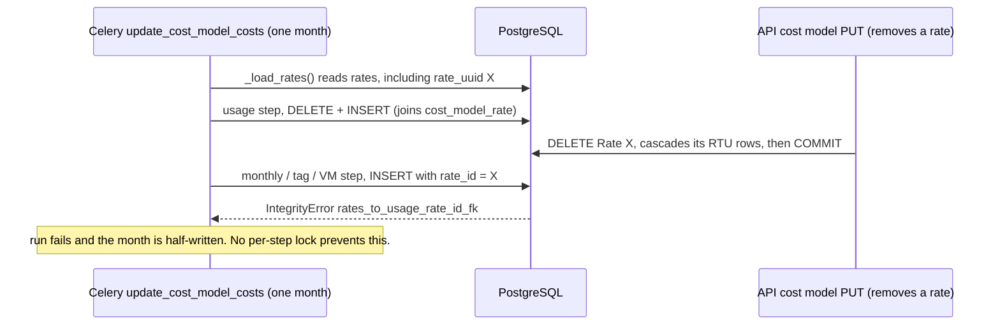
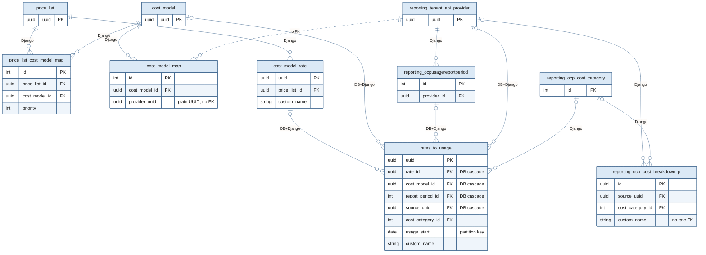

# COST-8113 RTU race map: findings, PRs, gaps

As of 2026-11-02 · Martin Povolny

## Summary

Removing a rate from a price list can still crash a running cost recalculation, and no open PR fixes that for most of the code that writes `rates_to_usage` (RTU). Jordi Gil's [COST-7249](https://redhat.atlassian.net/browse/COST-7249) "deadlock preflight" audit (August 2026) found ten issues around RTU (Findings A–J) and opened seven fix PRs. None of them is merged.

The PRs serialize work per provider with one advisory lock. That fixes races where both sides take the lock. It cannot fix the RTU inserts that take a `rate_uuid` loaded minutes earlier at the start of a month's run. That pattern is by design: the [PRD04 design doc](https://docs.google.com/document/d/1wWdrYuhNpiJPMgVdJzS6yTvCKxRZ1g5j6CLzLJjASHA/edit?tab=t.emwv4tp6xkon#heading=h.sdhov05ddhog) already specifies RTU `rate_id` as "FK -> Rate, Allow Null, CASCADE DELETE", and [`open-concerns.md` (Concern 3)](https://github.com/project-koku/koku/blob/8fc9d550945fdafe73285fdc5f923cfa4018830c/docs/architecture/cost-breakdown/open-concerns.md?plain=1#L38) has Python pass `Rate.uuid` into each insert. Neither discusses concurrent writers.

On main, the writers that hold the lock never set `rate_id` at all: distribution and markup write NULL, aggregation and breakdown write other tables. So the rate-delete lock in [#6414](https://github.com/project-koku/koku/pull/6414) protects nothing against the `rate_id` FK crash until [#6272](https://github.com/project-koku/koku/pull/6272) locks the usage-rates insert, and even then the monthly, tag, VM and GPU inserts stay exposed.

**Recommendation:** remove the `rate_id` cascade instead of locking around it (see [Proposal](#proposal-remove-the-rate_id-cascade)). Nothing reads `rates_to_usage.rate_id`, and RTU is rebuilt per date range on every run, so the cascade only deletes intermediate rows early, and its FK check is what crashes the inserts. Dropping it fixes Finding E and the stale `rate_uuid` for every writer with no lock, no 409 and no flag. [#6414](https://github.com/project-koku/koku/pull/6414) then shrinks to its two transaction fixes. This reverses a design decision; **the team agreed to it on 2026-11-03**. The general rule behind it is in [Design principle](#design-principle-no-database-cascades-on-reporting-data): no database cascades on derived, partitioned reporting data.

**Current flag state (2026-11-02, read from Unleash with `unleash-get`):** the RTU pipeline flag `cost-management.backend.cost_breakdown_rates_to_usage` is **off in stage** (the flag exists with a 100% rollout strategy, but the environment is disabled) and **does not exist in prod** (HTTP 404, so it evaluates false; the code uses `dev_fallback=False`). No tenant writes `rates_to_usage` today, so Finding E, the stale `rate_uuid`, the RTU parts of Findings A, B and F, and COST-8112 cannot happen in stage or prod. They must be fixed before the stage flag is turned on. Not behind that flag and live today: the API rate-table sync and its partial commits (R4, R5), `_ensure_rate_sync` on the read replica (R10), and the partition-drop deadlocks (Findings H, I). `cost-management.backend.disable_price_list` does not exist in either environment, so the worker reads rates from the price-list tables everywhere.

**Feature flags for our fixes: not needed.** Removing the `rate_id` cascade only changes what happens to RTU rows, and RTU is empty while the RTU flag is off; a migration cannot be flagged anyway. The transaction fixes for the price list and cost model PUTs are plain bug fixes in the API. #6414's `rate_sync_provider_lock` flag goes away with its lock. Exception: the locks added by #6102 (`Provider.delete()`) and #6269 (retention purge) run whatever the RTU flag says, and they wait on `_distribution_provider_lock`, which the legacy path also takes in `populate_distributed_cost_sql` (markup-to-RTU and aggregation run only when RTU is on), so those two change prod behaviour today.

## Branch work log

Setup, artifacts and how to run everything (local and ephemeral): [`README.md`](README.md).

All fixes land on the long-running branch **`mpovolny/rtu-hardening`** (from `main` at `1941b81e9`, 2026-11-03), one commit per issue. No PR until everything is fixed and tested; then the branch is split into PRs back to `main` (migrations separate from code, per repo rules). This file lives on the branch at `dev/rtu-hardening/rtu-race-map.md`.

| # | Issue | Status | Commit |
|---|---|---|---|
| 1 | Drop the `rate_id` and `cost_model_id` FK constraints and cascades on `rates_to_usage` (Finding E, R8, R11 part) | Done: migration `0355`, model `DO_NOTHING` + `db_constraint=False`, tests rewritten to the new contract | `d50cafd5e` |
| 1b | Remove RTU rows of deleted rates and cost models now that the cascade is gone. RTU is intermediate (no API reads it; only the pipeline, scoped to the run's window), and recalculation rebuilds only the processed months, so older months would keep dead rows | Done: task `delete_rates_to_usage_rows` (cost model queue, one indexed `DELETE ... WHERE rate_id = ANY(...) OR cost_model_id = ANY(...)`), scheduled `on_commit` by `sync_rate_table` (removed rates), `PriceListManager.delete` (its rates) and cost model DELETE; never inside the API request, nothing on rollback | see `git log` |
| 1c | Distributed RTU rows (`worker_distributed`, `platform_distributed`, ...) copied the rate's `custom_name` but wrote `rate_id = NULL`, so neither the old cascade nor `delete_rates_to_usage_rows` removed them when the rate was deleted (2,232 rows left in the ephemeral test until their month was recalculated) | Done: the per-rate pool in all six RTU distribution templates (platform, worker, unattributed storage and network in `sql/`; GPU in `trino_sql/` and `self_hosted_sql/`) groups by `rate_id` and writes it; negation and infra-only rows keep `rate_id = NULL`. Totals are unchanged (the fan-out is linear in the pool cost). Tests: `test_phase4_distribution` test_12 / test_13 (red before) | branch commit `[COST-8113] Carry rate_id into distributed RTU rows` |
| 2 | Atomic price list PUT and cost model PUT (R4, R5), without the advisory lock | Done: `PriceListManager.update` saves and syncs rates in one transaction; `CostModelSerializer.update` runs `update_provider_uuids` and `update` in one transaction, so the on-commit recalculation runs only if both succeed. No new HTTP responses (still 400), nothing for OpenAPI. Tests: `cost_models.test.test_atomic_updates` (both red before) | branch commit `[COST-8113] Make price list and cost model updates atomic` |
| 3 | `report_period_id` / `source_uuid` FKs: explicit RTU deletes, then drop those cascades too (Findings B, F, COST-8112) | Done: migration `0356` drops both constraints (model `DO_NOTHING` + `db_constraint=False`); `reporting/provider/ocp/rates_to_usage_deletes.py` deletes RTU rows before their parents in `Provider.delete()` (OCP, by `source_uuid`) and both OCP retention purges (by `(source_uuid, report_period_id)`), using the existing source-leading index. Deploy order: explicit deletes one release before `0356` (the old release's `Provider.delete()` relies on the database cascade); only matters once the RTU flag is on, see [Merge and ship order](#merge-and-ship-order). Known limitation: a pipeline insert racing a provider delete now succeeds instead of failing, leaving rows of a deleted source until retention drops their partitions. Tests: `reporting.provider.ocp.test.test_rtu_parent_deletes` (3 deleters red before the explicit deletes) | branch commit `[COST-8112] Drop the rates_to_usage report period and source cascades` |
| 4 | RTU writers without the provider lock (R7), re-scoped: the FK crash they risked is gone (items 1, 3); what remains is double-counting. Each writer deletes its window, then inserts; `update_cost_model_costs` runs for one provider with different, overlapping windows run concurrently (WorkerCache keys on the dates), and under READ COMMITTED one run's DELETE misses the other's uncommitted rows, so both survive and the daily summary aggregation counts them twice (the reason `_distribution_provider_lock` exists, #6162) | Done: decorator `_rtu_writer_provider_lock` runs the seven unlocked writers (usage, monthly incl. GPU/VM core, tag, node tag, VM, tag usage, tag usage default, tag based) under `_distribution_provider_lock(provider)` for their whole delete-and-insert sequence, only when they write RTU (`use_rtu=False` legacy calls unchanged, so no prod effect while the RTU flag is off). Tests: `masu.test.database.test_rtu_writer_lock` (two real overlapping `populate_usage_rates_to_usage` runs: 32 rows instead of 16 before, 16 after); accessor and OCP processor suites: identical 38 pre-existing failures with and without the change | branch commit `[COST-8112] Serialize every rates_to_usage writer per provider` |
| 5 | Partition-drop deadlocks (Findings H, I) | Done: ported #6270 / #6271 as one helper, `koku.pg_partition.drop_expired_partitions` (one statement per parent table; the purge runs in autocommit, so each commits alone and holds at most one parent ACCESS EXCLUSIVE lock), used by the OCP, AWS, Azure and GCP purges by date. Jordi's threaded spike tests are not ported (they rebuild the SQL by hand instead of calling the cleaners, and `skipTest` on missing fixtures); they stay the evidence for the deadlock. Tests: `koku.test.test_drop_expired_partitions` (statement shape red before) | branch commit `[COST-8115] Drop expired partitions one parent table at a time` |
| 6 | `_ensure_rate_sync` on the read replica (R10), and the rename bug it exposed (R12) | Done: the rates GET no longer syncs; `rate_sync.match_rates_to_json` maps JSON entries to Rate rows read-only, with the same matching as `sync_rate_table`. `_classify_incoming_rates` now generates a missing `custom_name` the way migration 0013 did (among the payload's own names) and takes the existing rate of that name, instead of always creating a `-2` rate. No API shape change. Tests: `cost_models.test.test_price_list_view` (sync identity and no-writes GET red before; four lazy-sync tests replaced) | branch commit `[COST-8113] Keep rate identity for JSON without rate_id; no writes on the rates GET` |
| 7 | OpenAPI: document any new error responses | To do with 2 Gap found 2026-11-04: `docs/specs/openapi.json` documents `/price-lists/`, `/price-lists/{price_list_uuid}/` and `/affected-cost-models/`, but not `GET /price-lists/{uuid}/rates/` (#6104) or the duplicate action; pre-existing, repo rule 5 | |
| 9 | The API exposes no usable `rate_id` (decided 2026-11-04: keep it that way) | Done: no consumer needs `Rate.uuid` (koku-ui main selects rates by array index and strips `rate_id`; the breakdown API labels by `custom_name`; IQE strips it), so by FedRAMP CM-7 (least functionality) it is not exposed in either direction. Removed it from `GET /price-lists/<uuid>/rates/`, the last place it appeared; input keeps dropping it (#6123). `custom_name` is the rate identity, a rename creates a new Rate. Design docs `api-and-frontend.md` (v5.0) and `open-concerns.md` (v2.1) record the decision and supersede the read-write `rate_id` design. Test: `test_price_list_view.test_rates_endpoint_does_not_expose_rate_id` (red before) UI: unused `Rate.rate_id` and its two workarounds removed in [koku-ui#5871](https://github.com/project-koku/koku-ui/pull/5871). | branch commit `[COST-7703] Stop exposing rate_id in the price list rates endpoint` |
| 8 | Local test failures (15 in `test_phase2_rates_to_usage`, the worker zero-rate test, later 38 in the accessor and OCP processor suites, 5 parquet summary updaters, 2 provider statistics) | Done: a stale test DB, not bugs. `KEEPDB` defaults to True and the runner loads its date-relative fixture data only when it creates the DB; ours was built in October, so every test expecting November data failed. Rebuilt with `KEEPDB=False`: 427 tests in those suites, 1 error left, which was ours (TC-51 `test_rates_to_usage_in_cleaner_base_list` patched `PartitionedTable` in the cleaner, removed by item 5; it hid among the failures because the comparison baseline already had item 5). Fixed; full suite 4,935 tests OK. `KokuTestRunner` now recreates a kept test DB whose newest fixture report period predates the current month (commit `Recreate a stale kept test DB automatically`); `docs/agent/testing.md` describes it | branch commit `Fix TC-51 for drop_expired_partitions; document the stale kept test DB` |

## Test data

Two tiers, scripts in `dev/rtu-hardening/testdata/`:

- **Tier 1, database only** (works now). [`seed_rtu.py`](testdata/seed_rtu.py) creates one price list with 30 rates, two cost models attached to it, and synthetic RTU rows on an existing OCP provider and report period (default 10,000 rows per rate per month for 3 months; `RTU_SEED_*` variables scale it). Everything is prefixed `rtu-seed`, and `RTU_SEED_CLEANUP=1` removes exactly that. [`measure_rate_delete.sh`](testdata/measure_rate_delete.sh) runs `EXPLAIN (ANALYZE, BUFFERS)` of rate deletes with and without the two constraints, each in a rolled-back transaction.

  ```bash
  # from the koku repo root, with the dev DB environment (DATABASE_* variables)
  RTU_SEED_ROWS_PER_RATE_MONTH=20000 python koku/manage.py shell < dev/rtu-hardening/testdata/seed_rtu.py
  dev/rtu-hardening/testdata/measure_rate_delete.sh org1234567
  RTU_SEED_CLEANUP=1 python koku/manage.py shell < dev/rtu-hardening/testdata/seed_rtu.py
  ```

  Results (2026-11-03, local `koku-db`, PostgreSQL 16.14, 1.8M RTU rows, 5 partitions, schema at `main`'s 0354):

  | Delete | With constraints (`main`) | Constraints dropped (branch) |
  |---|---|---|
  | 1 rate (60,000 RTU rows) | 150 ms | 0.18 ms |
  | All 30 rates of the price list (1.8M RTU rows) | 7,283 ms | 1.1 ms |

- **Tier 2, full pipeline** (to do). Runs `update_cost_model_costs` with `cost-management.backend.cost_breakdown_rates_to_usage` on, so every RTU writer runs: the existing on-prem nise data (`dev/scripts/nise_ymls/ocp/ocp_on_premise.yml`: 12 nodes, 28 pods, 17 PVCs, 16 GPUs, KubeVirt VMs) and cost model (`dev/scripts/cost_models/openshift_on_prem_cost_model.json`: 16 rates, all distribution types) cover every writer. To add, on a nise-populator branch: a second OCP cluster whose cost model shares the price list (Finding E blast radius), and a step that creates those cost models and the price list through the koku API. Needs a stack running this branch (local or ephemeral) with Unleash and the RTU flag on. **Ephemeral without a PR:** [`ephemeral/deploy.sh`](ephemeral/deploy.sh) builds the branch image (`linux/amd64`), pushes it to your own public quay repo, writes `dev/config.yaml` for bonfire (local component = this repo, our image tag), reserves a namespace, creates the secrets, deploys `hccm`, and turns the RTU flag on in every environment of the namespace's Unleash (`admin` user from the runbook). Steps: `build`, `config`, `reserve`, `secrets`, `deploy`, `flag`, `release`. Based on service-docs `docs/Testing/ephemeral-envs.md` ("Deploy a Branch To Ephemeral Cluster").
- **Prod-derived sizing** (to do, needs `oc login` to prod): rates per cost model, and daily summary rows per tenant for the largest tenants, to size Tier 1 runs. RTU itself is empty in prod (flag off).

## The problem

RTU rows are written by a long Celery run and deleted by unrelated operations, with nothing tying the two together. `rates_to_usage` holds one cost row per rate, partitioned by `usage_start`. It feeds the OCP daily summary (`aggregate_rates_to_daily_summary`) and the cost-breakdown table (`reporting_ocp_cost_breakdown_p`).

**How it is written.** `update_cost_model_costs` runs per provider and per month. It calls `_load_rates()` once at the start of each month ([`ocp_cost_model_cost_updater.py:69`](https://github.com/project-koku/koku/blob/8fc9d550945fdafe73285fdc5f923cfa4018830c/koku/masu/processor/ocp/ocp_cost_model_cost_updater.py#L69)), then runs a dozen steps over several minutes. Each step is a DELETE then INSERT, and each statement autocommits on its own. `WorkerCache` only stops two runs with the same provider *and* date range ([`tasks.py:1136-1141`](https://github.com/project-koku/koku/blob/8fc9d550945fdafe73285fdc5f923cfa4018830c/koku/masu/processor/tasks.py#L1136-L1141)); overlapping ranges still run at the same time.

**How it is deleted.** Four operations remove RTU rows through foreign keys ([migration 0353](https://github.com/project-koku/koku/blob/8fc9d550945fdafe73285fdc5f923cfa4018830c/koku/reporting/migrations/0353_rtu_schema_improvements.py#L45)):

- a rate removed in the API: `sync_rate_table` deletes the `Rate`, cascading on `rate_id`
- `Provider.delete()`: cascades on `report_period_id` and `source_uuid` (FKs are `DEFERRABLE INITIALLY DEFERRED`)
- the monthly retention purge: `cascade_delete()` of expired report periods, then dropping partitions
- a cost model DELETE: cascades on `cost_model_id`

**How it breaks:**

1. **FK crash during a write.** A delete commits while a step's INSERT references the deleted row. The INSERT fails with `IntegrityError`, the run fails, and that month's RTU is left half-written (a step's DELETE has already committed). Findings B and E, [COST-8112](https://redhat.atlassian.net/browse/COST-8112).
2. **Stale rate UUID.** Monthly, tag, VM and GPU inserts get `{{rate_uuid}}` from `_load_rates()`. If the rate is deleted and committed after that, the next insert fails the FK, however the delete was locked.
3. **Silent loss.** The retention purge commits its deletes in small batches, so a row written in between is deleted with no error (Finding F).

Next to these are deadlocks from dropping partitions (Findings H, I) and lock bookkeeping: leaks and unbounded waits (Finding G, [COST-8126](https://redhat.atlassian.net/browse/COST-8126)).



## Tables and foreign keys

All tables live in the tenant schema (`orgNNNNNNN`). Every FK below has `on_delete=CASCADE` in Django, so deleting through the ORM walks the chain in Python (the delete collector). Only the four RTU FKs set by [migration 0353](https://github.com/project-koku/koku/blob/8fc9d550945fdafe73285fdc5f923cfa4018830c/koku/reporting/migrations/0353_rtu_schema_improvements.py#L45) also cascade **in the database** (`ON DELETE CASCADE DEFERRABLE INITIALLY DEFERRED`), so raw SQL deletes and `cascade_delete()` reach `rates_to_usage` too. The other constraints are Django's default (`NO ACTION`, deferred).

Edge labels: **DB+Django** = cascades in the database and in Django; **Django** = cascades only through the ORM; **no FK** = plain UUID column. FK columns are listed in each table.



| FK | Django `on_delete` | Database constraint | Who deletes the parent | Effect on RTU |
|---|---|---|---|---|
| `rates_to_usage.rate_id` → `cost_model_rate` | CASCADE | CASCADE, deferred (0353) | `sync_rate_table` (rate removed in a PUT) | Deletes the rate's RTU rows in all months; a running insert with that `rate_id` fails (Finding E, R8). **Proposal: drop.** |
| `rates_to_usage.cost_model_id` → `cost_model` | CASCADE | CASCADE, deferred (0353) | Cost model DELETE | Deletes all RTU rows of the cost model; same race (R11) |
| `rates_to_usage.report_period_id` → `reporting_ocpusagereportperiod` | CASCADE | CASCADE, deferred (0353) | `Provider.delete()`, retention purge | Finding B, COST-8112, Finding F |
| `rates_to_usage.source_uuid` → `reporting_tenant_api_provider` | CASCADE | CASCADE, deferred (0353) | `Provider.delete()` | Finding B |
| `rates_to_usage.cost_category_id` → `reporting_ocp_cost_category` | CASCADE | Django default | Cost category delete | Not part of the audit |
| `cost_model_rate.price_list_id` → `price_list` | CASCADE | Django default | Price list DELETE (only when unassigned) | Via the rate, the `rate_id` cascade above |
| `price_list_cost_model_map.*` → `price_list`, `cost_model` | CASCADE | Django default | Price list / cost model DELETE | None directly |
| `cost_model_map.cost_model_id` → `cost_model` | CASCADE | Django default | Cost model DELETE | None directly |
| `cost_model_map.provider_uuid` | – (plain `UUIDField`) | none | – | Why `Provider.delete()` never touches cost models (Finding J) |
| `reporting_ocp_cost_breakdown_p.source_uuid`, `.cost_category_id` | CASCADE | Django default | `Provider.delete()`, cost category delete | Breakdown table has no FK to `cost_model_rate`; it keys rates by `custom_name` |

Sources: [`cost_models/models.py`](https://github.com/project-koku/koku/blob/8fc9d550945fdafe73285fdc5f923cfa4018830c/koku/cost_models/models.py), [`RatesToUsage`](https://github.com/project-koku/koku/blob/8fc9d550945fdafe73285fdc5f923cfa4018830c/koku/reporting/provider/ocp/models.py#L1044), [`reporting/provider/models.py`](https://github.com/project-koku/koku/blob/8fc9d550945fdafe73285fdc5f923cfa4018830c/koku/reporting/provider/models.py), [migration 0353](https://github.com/project-koku/koku/blob/8fc9d550945fdafe73285fdc5f923cfa4018830c/koku/reporting/migrations/0353_rtu_schema_improvements.py#L45).

## Findings map

### Jordi's audit ([COST-7249](https://redhat.atlassian.net/browse/COST-7249) deadlock preflight)

| ID | Finding | Ticket | Fix PR (state) | Notes |
|---|---|---|---|---|
| A | Concurrent breakdown population deadlocks or silently corrupts `reporting_ocp_cost_breakdown_p` | [COST-8117](https://redhat.atlassian.net/browse/COST-8117) | [#6102](https://github.com/project-koku/koku/pull/6102) (open) | Ticket says "merged as part of [#6102](https://github.com/project-koku/koku/pull/6102)": it means the [#6102](https://github.com/project-koku/koku/pull/6102) branch, which is not merged. |
| B | `Provider.delete()` vs RTU writer: FK `IntegrityError` on the deferred report-period FK | [COST-8118](https://redhat.atlassian.net/browse/COST-8118) | [#6102](https://github.com/project-koku/koku/pull/6102) (open) | Adds `Provider._rtu_distribution_lock`. Protects only writers that also lock. |
| C, D | Not found | – | – | No ticket, PR, repo doc or the [COST-7249 design doc](https://docs.google.com/document/d/1wWdrYuhNpiJPMgVdJzS6yTvCKxRZ1g5j6CLzLJjASHA/edit?tab=t.emwv4tp6xkon#heading=h.sdhov05ddhog) mentions them. Jordi confirmed (2026-11-03) he has no record of them; closed as unavailable. |
| E | `sync_rate_table` stale-rate delete vs RTU writer: `rates_to_usage_rate_id_fk` crash | [COST-8113](https://redhat.atlassian.net/browse/COST-8113) | [#6268](https://github.com/project-koku/koku/pull/6268) → [#6414](https://github.com/project-koku/koku/pull/6414) (draft) | Ticket says "every RTU write path ... take that lock"; false on main (see writers table). |
| F | Retention purge cascade silently deletes rows written during the purge | [COST-8114](https://redhat.atlassian.net/browse/COST-8114) | [#6269](https://github.com/project-koku/koku/pull/6269) (open) | Adds another `_multi_provider_distribution_lock` copy. |
| G | `sync_rate_table` session lock leaks on a DB error inside the caller's transaction | [COST-8119](https://redhat.atlassian.net/browse/COST-8119) | [#6268](https://github.com/project-koku/koku/pull/6268) (open) | Gone in [#6414](https://github.com/project-koku/koku/pull/6414): transaction-level locks have no unlock statement. |
| H | OCP partition drop holds ACCESS EXCLUSIVE on several parent tables in one statement: deadlock | [COST-8115](https://redhat.atlassian.net/browse/COST-8115) | [#6270](https://github.com/project-koku/koku/pull/6270) (open) | Fix: one statement per table. A provider lock would not help (DDL locks the whole table). |
| I | Same as H for AWS/Azure/GCP cleaners | [COST-8116](https://redhat.atlassian.net/browse/COST-8116) | [#6271](https://github.com/project-koku/koku/pull/6271) (open) | |
| J | AB-BA deadlock `Provider.delete()` vs `CostModelManager` → `sync_rate_table` | none (comment on [COST-7249](https://redhat.atlassian.net/browse/COST-7249)) | – | Ruled out: only one shared resource. [#6414](https://github.com/project-koku/koku/pull/6414) adds a CostModel row lock before the advisory lock, but `Provider.delete()` never touches cost model rows, so the argument still holds. |

Related tickets from the same audit, without a letter:

| Ticket | Issue | Fix PR (state) |
|---|---|---|
| [COST-8112](https://redhat.atlassian.net/browse/COST-8112) | `populate_usage_rates_to_usage` (first RTU insert) takes no lock | [#6272](https://github.com/project-koku/koku/pull/6272) (open) |
| [COST-8126](https://redhat.atlassian.net/browse/COST-8126) | `sync_rate_table` lock waits forever | [#6274](https://github.com/project-koku/koku/pull/6274) (draft) – superseded by [#6414](https://github.com/project-koku/koku/pull/6414)'s 5 s budget |
| [COST-8120](https://redhat.atlassian.net/browse/COST-8120) | GPU/VM SQL binds a UUID against a varchar `source` column (on-prem crash) | [#6273](https://github.com/project-koku/koku/pull/6273) (open) – unrelated to the races |

### Review findings ([#6268](https://github.com/project-koku/koku/pull/6268) reviews and our review of [#6414](https://github.com/project-koku/koku/pull/6414))

| # | Finding | Source | Status |
|---|---|---|---|
| R1 | [#6268](https://github.com/project-koku/koku/pull/6268)'s session lock is released before the caller's transaction commits (`CostModelManager`, `_ensure_rate_sync`) | Novohudonossor on [#6268](https://github.com/project-koku/koku/pull/6268) | Fixed in [#6414](https://github.com/project-koku/koku/pull/6414) (`pg_advisory_xact_lock`); reproduced against [#6268](https://github.com/project-koku/koku/pull/6268)'s code |
| R2 | A failed 2nd+ lock acquisition aborts the transaction and leaks the locks already taken | Novohudonossor on [#6268](https://github.com/project-koku/koku/pull/6268) | Fixed in [#6414](https://github.com/project-koku/koku/pull/6414) |
| R3 | Provider list read before locking misses concurrently added mappings | Novohudonossor on [#6268](https://github.com/project-koku/koku/pull/6268) | Narrowed, documented as a known gap |
| R4 | Price list PUT commits the rates JSON even when the sync returns 409 | CodeRabbit on [#6414](https://github.com/project-koku/koku/pull/6414) | Fixed, `2894cf174` (pushed) |
| R5 | Cost model PUT commits source changes and dispatches recalculation even when the rate update returns 409 | CodeRabbit on [#6414](https://github.com/project-koku/koku/pull/6414) | Fixed locally, **not pushed** |
| R6 | A source unmapped earlier in the same transaction is not locked, yet its RTU rows are cascaded | Our review | Fixed locally, **not pushed** (locks providers owning RTU rows for the deleted rates) |
| R7 | The writers that set `rate_id` take no lock; the ones that lock never set it | Our review | Partly: [#6272](https://github.com/project-koku/koku/pull/6272) locks usage rates. Monthly/tag/VM/GPU: no PR |
| R8 | Stale `rate_uuid` passed into monthly/tag/VM/GPU inserts | Our review | No PR; locking cannot fix it |
| R9 | `docs/specs/openapi.json` has no 409 for `PUT /cost-models/{uuid}/` and `PUT /price-lists/{uuid}/` | Our review | Missing in [#6414](https://github.com/project-koku/koku/pull/6414) |
| R10 | `_ensure_rate_sync` runs on `koku-api-reads`, which in production uses the read replica (template default `USE_READREPLICA: "false"`; the service-docs production debugging cookbook: API reads run on the replica): its writes fail, so in prod the `/price-lists/<uuid>/rates/` endpoint returns pre-0013 price lists without their `tiered_rates` / `tag_rates` | Our review | Fixed on the branch (item 6) |
| R11 | Cost model DELETE cascades RTU on `cost_model_id` with no lock | Our review | Resolved on the branch: no `cost_model_id` constraint or cascade any more (item 1); the cleanup task deletes the rows after commit (item 1b) |
| R12 | `sync_rate_table` generated missing `custom_name`s while avoiding every existing Rate name, so JSON without `custom_name` (every price list from before migration 0013, never written back) never matched its rows: a sync deleted and recreated every Rate with a new UUID and a `-2` name. Live in prod on any PUT of such a price list that sends its rates back without names | Found while fixing R10 (test `test_sync_rate_table_keeps_rates_of_json_without_rate_id`, red before) | Fixed on the branch (item 6) |

## RTU writers and deleters

Whether each path takes the per-provider advisory lock (`hashtext(provider_uuid)`) and whether its rows reference a `Rate`.

| Path | Writes | `rate_id` in its rows | Lock on main | Lock after open PRs |
|---|---|---|---|---|
| `populate_usage_rates_to_usage` ([`insert_usage_rates_to_usage.sql`](https://github.com/project-koku/koku/blob/8fc9d550945fdafe73285fdc5f923cfa4018830c/koku/masu/database/sql/openshift/cost_model/usage_rates/insert_usage_rates_to_usage.sql)) | RTU | Joined from `cost_model_rate` when the statement runs | No | Yes, [#6272](https://github.com/project-koku/koku/pull/6272) |
| `populate_monthly_cost_sql` ([`monthly_cost_*_rtu.sql`](https://github.com/project-koku/koku/tree/8fc9d550945fdafe73285fdc5f923cfa4018830c/koku/masu/database/sql/openshift/cost_model)) | RTU | `{{rate_uuid}}` parameter from `_load_rates()` | No | No |
| Tag-rate inserts (`*_tag_rates_rtu.sql`, `node_cost_by_tag_rtu.sql`) | RTU | `{{rate_uuid}}` parameter | No | No |
| VM / GPU inserts (`trino_sql/.../hourly_vm_*_rtu.sql`, `monthly_vm_core_rtu.sql`, `monthly_cost_gpu_rtu.sql`, ...) | RTU | `{{rate_uuid}}` parameter | No | No |
| `populate_markup_rates_to_usage` ([`insert_markup_rates_to_usage.sql`](https://github.com/project-koku/koku/blob/8fc9d550945fdafe73285fdc5f923cfa4018830c/koku/masu/database/sql/openshift/cost_model/usage_rates/insert_markup_rates_to_usage.sql)) | RTU | NULL | Yes ([`:1610`](https://github.com/project-koku/koku/blob/8fc9d550945fdafe73285fdc5f923cfa4018830c/koku/masu/database/ocp_report_db_accessor.py#L1610)) | Yes |
| `populate_distributed_cost_sql` ([`distribute_*_rtu.sql`](https://github.com/project-koku/koku/tree/8fc9d550945fdafe73285fdc5f923cfa4018830c/koku/masu/database/sql/openshift/cost_model/distribute_cost)) | RTU | NULL (column not written) | Yes ([`:960`](https://github.com/project-koku/koku/blob/8fc9d550945fdafe73285fdc5f923cfa4018830c/koku/masu/database/ocp_report_db_accessor.py#L960)) | Yes |
| `aggregate_rates_to_daily_summary` | daily summary (reads RTU) | – | Yes ([`:1644`](https://github.com/project-koku/koku/blob/8fc9d550945fdafe73285fdc5f923cfa4018830c/koku/masu/database/ocp_report_db_accessor.py#L1644)) | Yes |
| `_populate_cost_breakdown_ui_summary_table` | breakdown table (reads RTU) | – | No | Yes, [#6102](https://github.com/project-koku/koku/pull/6102) |
| **Deleters** | | | | |
| `sync_rate_table` stale-rate delete | cascades on `rate_id` | – | No | Yes, [#6414](https://github.com/project-koku/koku/pull/6414) (transaction-level, 5 s, 409) |
| `Provider.delete()` | cascades on report period / provider | – | No | Yes, [#6102](https://github.com/project-koku/koku/pull/6102) |
| Retention purge `cascade_delete()` | cascades on report period | – | No | Yes, [#6269](https://github.com/project-koku/koku/pull/6269) |
| Retention partition drop | DDL on parent tables | – | No | Split per table, [#6270](https://github.com/project-koku/koku/pull/6270) / [#6271](https://github.com/project-koku/koku/pull/6271) (no lock) |
| Cost model DELETE | cascades on `cost_model_id` | – | No | No |

Reading: the `rate_id` FK race (Finding E) involves only the first four rows. With every open PR merged, the usage-rates insert is protected and the three parameterized writers are not.

## PR map

| PR | Ticket | What it does | Covers | State / overlap |
|---|---|---|---|---|
| [#6102](https://github.com/project-koku/koku/pull/6102) | [COST-7249](https://redhat.atlassian.net/browse/COST-7249), 8117, 8118 | Cost breakdown API; locks breakdown population; `Provider.delete()` lock; flips RTU `dev_fallback` to True | A, B | Open since 2026-06-04. Large; tickets call its fixes "merged". |
| [#6268](https://github.com/project-koku/koku/pull/6268) | [COST-8113](https://redhat.atlassian.net/browse/COST-8113), 8119 | Session lock around `sync_rate_table` + inner `atomic()` | E, G | Closed; handed over to [#6414](https://github.com/project-koku/koku/pull/6414) (comment 2026-11-01). |
| [#6269](https://github.com/project-koku/koku/pull/6269) | [COST-8114](https://redhat.atlassian.net/browse/COST-8114) | Locks the retention purge cascade | F | Open. Third copy of the multi-provider lock helper. |
| [#6270](https://github.com/project-koku/koku/pull/6270) | [COST-8115](https://redhat.atlassian.net/browse/COST-8115) | OCP partition drop: one statement per table | H | Open. Independent of the lock work. |
| [#6271](https://github.com/project-koku/koku/pull/6271) | [COST-8116](https://redhat.atlassian.net/browse/COST-8116) | Same for AWS/Azure/GCP | I | Open. Independent. |
| [#6272](https://github.com/project-koku/koku/pull/6272) | [COST-8112](https://redhat.atlassian.net/browse/COST-8112) | Locks `populate_usage_rates_to_usage` | [COST-8112](https://redhat.atlassian.net/browse/COST-8112), part of R7 | Closed 2026-11-04, superseded by [#6425](https://github.com/project-koku/koku/pull/6425) (item 4 locks this writer and six more) |
| [#6273](https://github.com/project-koku/koku/pull/6273) | [COST-8120](https://redhat.atlassian.net/browse/COST-8120) | `\| string` on `source_uuid` in 22 GPU/VM templates | [COST-8120](https://redhat.atlassian.net/browse/COST-8120) | Open. Unrelated to the races. |
| [#6274](https://github.com/project-koku/koku/pull/6274) | [COST-8126](https://redhat.atlassian.net/browse/COST-8126) | `lock_timeout` on [#6268](https://github.com/project-koku/koku/pull/6268)'s session lock | [COST-8126](https://redhat.atlassian.net/browse/COST-8126) | Closed 2026-11-04, superseded by [#6425](https://github.com/project-koku/koku/pull/6425) (cascades removed instead of locked around) |
| [#6414](https://github.com/project-koku/koku/pull/6414) | [COST-8113](https://redhat.atlassian.net/browse/COST-8113) | Shared `koku/advisory_locks.py`; transaction-level locks in `sync_rate_table` only when deleting rates; 5 s budget → 409; flag `rate_sync_provider_lock`; atomic price list and cost model PUTs | E, G, R1–R6 | Closed 2026-11-04, superseded by [#6425](https://github.com/project-koku/koku/pull/6425) (cascades removed instead of locked around) |

## Next steps (2026-11-04, updated 2026-11-11)

### Changes to the solution

Reviewed after all work log items were done. In priority order:

| # | Change | Why | State |
|---|---|---|---|
| S1 | Test whether the **legacy** (non-RTU) writers double-count under overlapping recalculations | Item 4 proved overlapping runs double RTU rows and locked the RTU writers only when `use_rtu=True`. The legacy `populate_monthly_cost_sql` deletes its window's monthly-cost rows from the daily summary and inserts new ones as separate statements, unlocked, and WorkerCache lets overlapping windows run together: possibly doubled monthly costs in prod today. Not yet tested | **Confirmed 2026-11-04**: `masu/test/database/test_legacy_monthly_cost_race.py` (real `populate_monthly_cost_sql`, `use_rtu=False`; run A pauses between its delete and its insert while run B writes an overlapping window) left 6 Cluster monthly-cost rows instead of 3 and cost 125.00 instead of 62.50: monthly costs double in the live (legacy) path. Ticket [COST-8575](https://redhat.atlassian.net/browse/COST-8575) (unassigned, Related to COST-8265 and COST-8546). **Prod check 2026-11-06 (read-only): no persistent doubling.** 56 tenants have cost models with monthly rates on active OCP sources; 12 have monthly-cost rows in 2026-10/11. Counting rows beyond one per natural key (the legacy insert's grouping plus the PVC/volume columns, since PVC monthly costs also group by PVC): 0 extra rows for all 12, every day 2026-10-01..2026-11-06 (~1.7 M rows). A doubled window lasts only until the next run over it deletes and rewrites it, and the current month is recalculated often, so short-lived doubles can still be visible but do not persist. Priority: normal correctness fix. The fix is S2 (with the test, uncommitted until then) |
| S2 | Decide: per-provider-month single-flight in `update_cost_model_costs` instead of per-writer locks | Fixes the overlap at its root for every table (RTU and legacy); item 4's decorator must otherwise be remembered on every new writer. Costs some parallelism within a month | **Decided 2026-11-06: single-flight (B).** Planned shape: a Postgres session advisory lock on (provider, month) around each month's iteration of the OCP updater, behind an enablement flag; WorkerCache key unchanged, so different months still run in parallel. Per-writer locks (A) were rejected: they leave runs interleaving between steps (mixed old and new rates across tables) and every new writer must remember the decorator. Busy lock (decided 2026-11-06, revised the same day): **wait briefly, then coalesce through the delayed tasks.** Blocking for up to the WorkerCache timeout (1 h / 4 h) was rejected: each waiting trigger would hold an idle worker (head-of-line blocking on the cost-model queues). Instead the run waits up to ~2 minutes for the lock, then writes or merges the provider-month's `DelayedCeleryTasks` row (`delayed_update_cost_model_costs`: one row per provider and billing month, date range widened to the hull) and returns. A busy-lock deferral never pushes the row's deadline later (keep the earlier deadline), so a stream of triggers cannot postpone the run indefinitely; size is bounded by one provider-month; the hull may widen a short window to most of the month. Prod check done (S1): no persistent doubling. Fixes COST-8575 and subsumes item 4. **Implemented in [#6442](https://github.com/project-koku/koku/pull/6442) (draft)**, flag `cost-management.backend.cost-model-single-flight`; the lock is taken in `update_cost_model_costs` around the whole update (distribution and UI summary run after the per-month loop, so a lock inside the loop would leave them out). The COST-8575 race test moved there, now proving the fix |
| S3 | Spike: does `rates_to_usage` need to persist between runs? | Its persistence is what needed cascades, cleanup, explicit deletes and locks. If every consumer reads it within one run, a per-run scope removes most of that. Partial-window runs may depend on earlier rows: verify | **Spike done 2026-11-11: RTU must persist; stay with the current design (A).** No API reads the table and all 25 SQL reads are date-filtered, but one reader's dates are wider than its run: the unallocated GPU distribution is `requires_full_month` (`ocp_report_db_accessor.py:1046`, `:1076-1112`). For a past month it distributes over the whole month whatever the run's window, and on the 2nd of the month a current-month run distributes the whole previous month; `distribute_unallocated_gpu_cost_rtu.sql` reads its source rows from `rates_to_usage` over that window, so rows written by earlier runs. Deleting a run's window at its end (C) would starve it; keeping rows without the cleanup (B) would feed it rows of deleted rates and cost models. So the explicit deletes, the cleanup task and the sweep (S4) are needed. A first reading of this spike concluded the opposite, having checked only that each read has a date filter. Other cross-run readers, harmless: the two summary updaters rebuild `reporting_ocp_cost_breakdown_p` from the previous run's rows just before the cost model run rebuilds it. To revisit C, the GPU distribution must first stop reading earlier runs' rows (for example past-month runs rewriting the full month); not planned before the split |
| S4 | Periodic sweep of RTU rows whose source, report period or rate is gone | Without FKs a run racing a delete can leave rows until the next rebuild or retention; a cheap sweep in the expired-data task bounds that | **Done 2026-11-06** (`sweep_orphaned_rates_to_usage`, daily beat, tenants with the RTU flag only; loose index scans, checked with EXPLAIN). Ephemeral E13 pass. May shrink after S3 |
| S5 | Ship fewer, smaller PRs (below) | The flag is off and RTU is empty, so the RTU ordering constraints are moot until it goes on; the fixes that matter now can merge independently | Merged: #6430, #6431, #6433, #6434, #6435. Ready for review: #6442. #6432 closed 2026-11-11 (stale); item 6 is now #6455 (draft). RTU code and migration PRs follow S3 |
| S6 | Small: document the remaining name-matching edge case (item 6), close E6's race window with an injected delay, remove #6102's `Provider.delete()` lock | Leftovers from the review | To do |
| S7 | Make single-flight the default, then drop item 4's per-writer lock (`_rtu_writer_provider_lock`) | Three lock layers today: the distribution lock (#6162), item 4's lock (RTU writers, only when `use_rtu`) and single-flight (#6442, behind its flag). Single-flight covers item 4's case. **Plan (2026-11-13):** enable `cost-management.backend.cost-model-single-flight` in stage, then prod; once it has run in prod (a billing cycle), it becomes the default and the flag and the unlocked path are removed. The RTU flag goes on only after that, so RTU always runs under single-flight and no "RTU implies single-flight" logic is needed | **To do, in order:** (1) inventory every caller of the 7 decorated RTU writers: any reachable outside `update_cost_model_costs` keeps its lock or is routed through it; (2) roll out single-flight (stage, prod); (3) remove the flag and the unlocked path, and decide synchronous calls (skipped by single-flight today; no production caller); (4) close the day-2 gap from COST-8586 (a run on the 2nd writes the previous month without that month's lock); (5) remove item 4's decorator and decide the distribution lock; rerun `test_rtu_writer_lock` and E9/E11. If the RTU flag must go on before (3), item 4's lock stays until then |
| S8 | Size `rates_to_usage` before the flag goes on in prod | Prod storage investigation (2026-11-06): the daily summaries bloat from delete-then-reinsert churn, and RTU has the same write pattern with about 11 indexes per partition (77,916 indexes over 7,095 partitions). RTU rows scale with daily summary rows times rates; one tenant has 110 M summary rows a month | To do: estimate RTU rows and size per tenant from prod row counts and rate counts (read-only); check which single-column indexes (`namespace`, `cluster_id`, `custom_name`, `monthly_cost_type`, `label_hash`) any query uses; roll out to small tenants first and keep the label-explosion tenant for last |
| S9 | On-prem defaults for the RTU and single-flight flags | `ONPREM_FLAG_DEFAULTS` (`koku/koku/feature_flags.py`) has no entry for either, so both are off on-prem | Product decision: is on-prem meant to get RTU? If yes, both flags need a default there (together, per S7) |
| S10 | Process: keep work-log edits (`dev/rtu-hardening/`) in their own commits | Commits mixing work log and code made the rebuilds of 2026-11-06 and 2026-11-10 fiddly; one superseded commit was absorbed instead of cleanly dropped | From now on |
| S11 | Check: how do the GPU distribution's previous-month rows reach the daily summary? | Found during the S3 spike, predates this work. On the 2nd of the month a current-month run distributes unallocated GPU cost for the whole previous month into `rates_to_usage` (`ocp_report_db_accessor.py:1076-1100`, sets `summarize_previous_month`), but `aggregate_rates_to_daily_summary` in that run is called with the current month's window (`ocp_cost_model_cost_updater.py`, `distribute_costs_and_update_ui_summary`). Not traced: whether another step aggregates the previous month (`populate_ui_summary_tables` handles `summarize_previous_month` for the UI tables), or the rows stay in RTU without reaching the daily summary | **Done 2026-11-11, [COST-8586](https://redhat.atlassian.net/browse/COST-8586), commit `d6064dcb8`.** Confirmed with tests, RTU path only. Worse than first thought: the distribution deletes the window's `gpu_distributed` daily summary rows before writing RTU, so on the 2nd the previous month *lost* its distributed GPU cost, and every later run on the 2nd redid the distribution (the completion check found nothing). Also hit: any past-month run with a partial window (late data), which dropped the distribution for the rest of the month. Fix: `populate_distributed_cost_sql` records each full-month distribution's window on the summary range; the RTU path re-aggregates that type's rows for the whole window (`aggregate_distributed_rates_to_daily_summary.sql`, replaces only that type) and refreshes the UI summaries beyond the run's dates. Tests in `TestGPUFullMonthDistributionAggregationRTU` (day 2, day-2 rerun finalized, partial past month, no duplicates). Legacy path unchanged. Open: the day-2 run writes the previous month without holding its single-flight lock (S7 design point) |
| S12 | Backfill `rate_id` / `custom_name` into legacy price list JSON, then remove the legacy matching code | Stored JSON without any `rate_id` predates rate identities (migration 0013 never wrote them back). Item 6 (#6455) handles it at read and sync time: `as_migrated()` (drops `custom_name` from such stored JSON so names are generated in 0013's order; added after CodeRabbit's review of #6455), the generated-name fallback in `_classify_incoming_rates`, and their tests. A one-time data migration writing the names and ids back in 0013's order makes all of that dead code. On-prem installs have their own data, so a zero count in prod alone does not justify removing the code | Low priority. After #6455 merges and the branch is rebuilt (the branch keeps the code until then): (1) optional read-only count of price lists with legacy JSON in prod, to judge urgency; (2) backfill migration, in its own PR (migration rules; can go with or after 0355/0356); (3) once it has run everywhere, remove `as_migrated`, the 0013 fallback and the no-`rate_id` test cases |

### Next actions (2026-11-11)

1. **#6442** (single-flight, COST-8575): **merged 2026-11-13** (`f731bdc0e`), with the review changes: the delayed-task sweep locks its rows, busy deferrals use deadline 0, and the deadline protection sticks to the row. Next: create the Unleash flag `cost-management.backend.cost-model-single-flight` (flexibleRollout, stickiness `schema`, off), enable it for a few tenants in stage, then prod; remove it after a billing cycle.
2. **S3 spike**: done 2026-11-11. RTU must persist (the GPU full-month distribution reads earlier runs' rows), so the current design stays and S8 sizing is a precondition for the prod flag.
3. **S7**: single-flight becomes the default (stage, prod, then flag and unlocked path removed) before the RTU flag goes on; then item 4's lock goes. First step: the caller inventory of the 7 decorated RTU writers.
4. **S8 sizing**: read-only prod estimate; can run alongside 3. A precondition for the prod flag now that RTU rows persist (S3).
5. **Item 6 PR**: [#6455](https://github.com/project-koku/koku/pull/6455) (draft), replaces the closed #6432; mark ready once CI is green.
6. **Split the RTU core** (items 1, 1b, 1c, 3, S4, COST-8586) per "Merge and ship order": code PR, then 0355, then 0356. Item 4's lock ships with the code PR only while single-flight is not yet the default (S7).
7. **S11**: done (COST-8586, `d6064dcb8`); split into its own PR with the RTU core.
8. **S9** decision and **S6** leftovers.
9. **S12**: backfill legacy price list JSON, then remove the legacy matching code (low priority, after #6455).

### Split into PRs

Small PRs for the fixes that matter now, independent of the RTU flag, each a draft cut from `main`, labelled for smoke tests and linking back to [#6425](https://github.com/project-koku/koku/pull/6425):

| Item | PR | Contents | Depends on |
|---|---|---|---|
| 2 | [#6430](https://github.com/project-koku/koku/pull/6430) | Atomic price list and cost model PUTs | **merged 2026-11-05** |
| 5 | [#6431](https://github.com/project-koku/koku/pull/6431) | Partition drop one table per statement (+ TC-51 test update) | **merged 2026-11-06** |
| 6 | [#6432](https://github.com/project-koku/koku/pull/6432) (closed 2026-11-11) | Read-only rates GET, rate identity for JSON without `rate_id` | closed as stale; replaced by [#6455](https://github.com/project-koku/koku/pull/6455) (draft, 2026-11-11), cut from main without the RTU cleanup hook |
| 9 | [#6433](https://github.com/project-koku/koku/pull/6433) | No `rate_id` in the rates endpoint; design docs record the CM-7 decision | **merged 2026-11-05** |
| 7 | [#6434](https://github.com/project-koku/koku/pull/6434) | OpenAPI for the price list endpoints, contract tests; the rates endpoint returns prices as numbers (as the detail does) | **merged 2026-11-06** |
| 8 | [#6435](https://github.com/project-koku/koku/pull/6435) | Test runner recreates a stale kept test DB; testing guide | **merged 2026-11-05** |
| - | [#6436](https://github.com/project-koku/koku/pull/6436) | Flaky Kafka watchdog test (hit #6430's CI) | **merged 2026-11-05** |
| - | [#6440](https://github.com/project-koku/koku/pull/6440) | Flaky staged ingress tests racing the claim heartbeat thread (hit #6430's CI) | **merged 2026-11-06** |
| S2 | [#6442](https://github.com/project-koku/koku/pull/6442) | Single-flight cost model updates per provider month (COST-8575) | **merged 2026-11-13** |

2026-11-06: the branch was rebuilt on `main` without its own commits for the merged #6430, #6433, #6434 and #6435 (backup: local branch `backup/rtu-hardening-pre-rebase-20261106`). Item 6's `price_list_view.py` change now sits on top of #6434's number rendering.
2026-11-13: rebased on `main` again, dropping the branch's copy of #6442 (main has the reviewed version; the single-flight files now match `main`). Backup: local branch `backup/rtu-hardening-pre-rebase-20261113`.

The RTU work proper (1, 1b, 1c, 3, 4) follows as the code PR plus one PR per migration, per the merge and ship order below.

## Merge and ship order

How the branch splits into PRs, and in which order they reach production. Migrations go in their own PRs (repo rule). Branch commits that mix code and migration (items 1 and 3) are split when the PRs are cut.

| Step | PR | Contents | Must follow | Why |
|---|---|---|---|---|
| 1 | Atomic PUTs (item 2) | `PriceListManager.update` and the cost model PUT in one transaction | nothing | Plain API bug fix, live on main today with or without the flag |
| 2 | RTU cleanup task (item 1b) | `delete_rates_to_usage_rows` task, `schedule_rates_to_usage_cleanup` hooks in `sync_rate_table`, `PriceListManager.delete`, cost model delete | nothing | With the cascade still in place the task finds nothing to delete, so it is harmless before step 3 |
| 3 | Migration `0355` (item 1) | Drop the `rate_id` / `cost_model_id` constraints, model `DO_NOTHING` | step 2 in production | Without the task, rows of deleted rates and cost models would stay until their range is rebuilt |
| 4 | Distributed rows carry `rate_id` (item 1c) | Six distribution templates | step 2 | Without it the cleanup task misses distributed rows (first ephemeral run: 2,232 left) |
| 5 | Explicit parent deletes (item 3, code) | `rates_to_usage_deletes.py`, calls in `Provider.delete()` and both OCP retention purges | nothing | With the cascades still in place the deletes run first and the cascade finds nothing; harmless |
| 6 | Migration `0356` (item 3) | Drop the `report_period_id` / `source_uuid` constraints, model `DO_NOTHING` | step 5 in production, one release earlier | The previous release's `Provider.delete()` relies on the database cascade; its retention purges still cascade through the Django relation |
| any | Partition-drop deadlocks (item 5) | Port of #6270 / #6271 | nothing | Independent of RTU, live today |
| any | Rate matching and read-only rates GET (item 6) | `match_rates_to_json`, the `custom_name` fallback in `_classify_incoming_rates`, the GET without lazy sync | nothing | Plain API bug fixes (R10, R11), live today |
| any | RTU writer lock (item 4) | `_rtu_writer_provider_lock` on seven writers | nothing | Acts only on RTU writes, so no effect while the flag is off; must be in production before the flag goes on |

**The order only matters once the RTU flag is on.** `cost-management.backend.cost_breakdown_rates_to_usage` is off in stage and does not exist in prod (see [Summary](#summary)), so `rates_to_usage` is empty in both. A wrong order can only leave behind rows that do not exist, and none of these PRs needs a feature flag. The rule that matters: every step above is in production before the flag is turned on in stage. Keeping the order anyway costs nothing and keeps the branch history honest for whoever turns the flag on.

## Proposal: remove the `rate_id` cascade

**Stop rate deletes from touching `rates_to_usage`.** That removes the race at its source instead of serializing around it.

### Why it is safe

- **Nothing reads `rates_to_usage.rate_id`.** No SQL template joins or filters on it and no Python code uses it; it appears only in INSERT column lists and in `ratestousage_rate_id_idx` (checked on main, 2026-11-02).
- **RTU is an intermediate table.** Every run deletes and rebuilds its date range ([risk register R11](https://github.com/project-koku/koku/blob/8fc9d550945fdafe73285fdc5f923cfa4018830c/docs/architecture/cost-breakdown/risk-register.md?plain=1#L107): one DELETE per window). The UI reads the daily summary and `reporting_ocp_cost_breakdown_p`, which the cascade never touches.
- **The cascade adds nothing.** It deletes RTU rows a little earlier than the next rebuild would. Its FK check is the only thing that turns a deleted rate into an `IntegrityError` for an insert.
- **Its original purpose was never built.** [`open-concerns.md` (Concern 3)](https://github.com/project-koku/koku/blob/8fc9d550945fdafe73285fdc5f923cfa4018830c/docs/architecture/cost-breakdown/open-concerns.md?plain=1#L38) chose CASCADE for "scoped recalculation" and a "future JOIN back to Rate". Neither exists: recalculation rebuilds the whole window.

### What it fixes

| Problem | Today | With the cascade removed |
|---|---|---|
| Finding E: rate delete vs RTU insert | `IntegrityError`; lock in [#6414](https://github.com/project-koku/koku/pull/6414) helps only writers that lock and set `rate_id` (none on main) | Cannot happen: no FK check on `rate_id` |
| R8: stale `rate_uuid` in monthly / tag / VM / GPU inserts | `IntegrityError`; no lock can fix it | Insert succeeds; the recalculation the PUT dispatches rebuilds the window without that rate |
| R7: writers that set `rate_id` take no lock | Needs [#6272](https://github.com/project-koku/koku/pull/6272) plus locks in ~20 templates | Irrelevant for `rate_id` (still relevant for Finding B, see below) |
| Finding G, R1–R3, R6, [COST-8126](https://redhat.atlassian.net/browse/COST-8126): lock leaks, early release, timeouts | Fixed by [#6414](https://github.com/project-koku/koku/pull/6414)'s transaction-level lock | Gone: `sync_rate_table` takes no lock |
| User-facing 409 while a recalculation runs | Introduced by [#6414](https://github.com/project-koku/koku/pull/6414) | Gone |

### Changes

1. **New migration PR** (repo rule: migrations in their own PR):
    - [`RatesToUsage.rate`](https://github.com/project-koku/koku/blob/8fc9d550945fdafe73285fdc5f923cfa4018830c/koku/reporting/provider/ocp/models.py#L1076) → `ForeignKey("cost_models.Rate", on_delete=models.DO_NOTHING, db_constraint=False, null=True, db_index=False)`. `DO_NOTHING` also stops Django's collector from issuing its own eager `DELETE FROM rates_to_usage WHERE rate_id IN (...)`.
    - Drop the `rate_id` FK constraint that [0353](https://github.com/project-koku/koku/blob/8fc9d550945fdafe73285fdc5f923cfa4018830c/koku/reporting/migrations/0353_rtu_schema_improvements.py#L45) created (`ON DELETE CASCADE DEFERRABLE INITIALLY DEFERRED`). Set `lock_timeout` in the migration: dropping a constraint on a partitioned table briefly takes an exclusive lock on the parent and its partitions.
    - Keep the column and `ratestousage_rate_id_idx`.
    - Test: delete a rate in one connection; insert RTU rows with that `rate_id` from another; the insert succeeds and the other RTU rows are untouched.
2. **Shrink [#6414](https://github.com/project-koku/koku/pull/6414) to the two transaction fixes** (R4, R5): the price list PUT and the cost model PUT each commit as one transaction. Both bugs exist on main without any lock: an invalid `rate_id` raises `ValueError` after `save()` has committed. Tests trigger the failure with an invalid `rate_id` instead of a lock timeout. Remove the lock, the 409, the `rate_sync_provider_lock` flag and `koku/advisory_locks.py` as new commits (the PR has review comments).
3. **No feature flag** for either PR: RTU is empty while `cost_breakdown_rates_to_usage` is off (stage and prod, 2026-11-02), and the transaction fixes are plain API bug fixes.
4. **Close [#6274](https://github.com/project-koku/koku/pull/6274).** Update [COST-8113](https://redhat.atlassian.net/browse/COST-8113) and [COST-8119](https://redhat.atlassian.net/browse/COST-8119): Finding E and G are fixed by removing the cascade, not by a lock.

### What it does not change

- **Finding B and [COST-8112](https://redhat.atlassian.net/browse/COST-8112)** ([#6102](https://github.com/project-koku/koku/pull/6102), [#6272](https://github.com/project-koku/koku/pull/6272)): `Provider.delete()` and the retention purge cascade on `report_period_id` and `source_uuid`. Those deletes remove the parent rows, and an orphaned RTU row there is wrong data, so those FKs and their locks stay.
- **R11, cost model DELETE** cascades on `cost_model_id`, which every RTU insert sets. [PRD04 "Data Retention"](https://docs.google.com/document/d/1wWdrYuhNpiJPMgVdJzS6yTvCKxRZ1g5j6CLzLJjASHA/edit?tab=t.emwv4tp6xkon#heading=h.sdhov05ddhog) wants that cascade, so it needs its own decision: the same treatment, or a lock.

### Costs and risks

- `rate_id` loses its referential check: an insert with a wrong UUID no longer fails. A future join back to `Rate` must be a LEFT JOIN.
- Rows for a deleted rate stay in RTU until their date range is rebuilt: the current month right after the PUT (the dispatched recalculation), past months at their next resummary. Nothing reads `rate_id`, so they are invisible.
- **Reverses a documented design decision** ([PRD04 data model](https://docs.google.com/document/d/1wWdrYuhNpiJPMgVdJzS6yTvCKxRZ1g5j6CLzLJjASHA/edit?tab=t.emwv4tp6xkon#heading=h.sdhov05ddhog), [`open-concerns.md` Concern 3](https://github.com/project-koku/koku/blob/8fc9d550945fdafe73285fdc5f923cfa4018830c/docs/architecture/cost-breakdown/open-concerns.md?plain=1#L38)). **Agreement reached (2026-11-03).**

### Fallback if the cascade stays

[#6414](https://github.com/project-koku/koku/pull/6414)'s lock, plus [#6272](https://github.com/project-koku/koku/pull/6272), plus a join guard (`WHERE EXISTS (SELECT 1 FROM cost_model_rate WHERE uuid = {{rate_uuid}})`) in the parameterized templates across `sql/` and `trino_sql/`, plus locks on those steps (a join still races an uncommitted delete). Much more code for a weaker guarantee.

## Design principle: no database cascades on reporting data

**Data that is rebuilt is deleted by the code that rebuilds it.** Derived, partitioned reporting tables get no database-level cascade and preferably no FK constraint; small configuration tables keep their FKs.

**Where cascades are today.** About 200 FKs across koku use Django's `on_delete=CASCADE` (the ORM's delete collector, in Python). Database-level `ON DELETE CASCADE` exists in exactly one place: the four `rates_to_usage` FKs set by [migration 0353](https://github.com/project-koku/koku/blob/8fc9d550945fdafe73285fdc5f923cfa4018830c/koku/reporting/migrations/0353_rtu_schema_improvements.py#L45). Django-only CASCADE arrived in [#6177](https://github.com/project-koku/koku/pull/6177) (2026-07-21, COST-7736, after a prod failure of the previous `SET_NULL`); the database-level part in [#6219](https://github.com/project-koku/koku/pull/6219) (2026-07-27). Everywhere else, bulk deletes go through [`cascade_delete()`](https://github.com/project-koku/koku/blob/8fc9d550945fdafe73285fdc5f923cfa4018830c/koku/koku/database.py#L324) and [`Provider._get_linked_table_names()`](https://github.com/project-koku/koku/blob/8fc9d550945fdafe73285fdc5f923cfa4018830c/koku/api/provider/models.py#L389).

### Why not

1. **Scale: a cascade is an unbounded delete hidden in a small action.** Deleting one `cost_model_rate` row deletes from every partition of `rates_to_usage`: the table is partitioned by `usage_start` but the cascade filters on `rate_id`, so no partition is pruned. Prod held about 15.6M RTU rows before #6177's truncate. `DEFERRABLE INITIALLY DEFERRED` defers only the FK *check*; the cascade action runs immediately, inside the DELETE statement of the API request (it shows as `Trigger for constraint rates_to_usage_rate_id_..._fk` in `EXPLAIN ANALYZE`), inside the 30 s gateway budget, and loads the primary (WAL, replica lag, row locks). **Measured locally** (1.8M seeded RTU rows over 3 months, [Test data](#test-data)): deleting 1 rate (60k RTU rows) takes 150 ms with the constraint and 0.18 ms without; deleting all 30 rates of the price list (what a PUT with fewer rates does) takes **7.3 s** with the constraint and 1.1 ms without. A rate edit should cost one row, not the tenant's history.
2. **It bypasses the code that owns the data.** The pipeline coordinates RTU writes per provider and per window (`WorkerCache`, `_distribution_provider_lock`, DELETE-then-INSERT). A cascade deletes outside that coordination, and the FK it rides on then fails the next insert. Findings B, E and F and COST-8112 all come from this.
3. **Derived data needs no referential integrity.** RTU, the daily summaries and the UI summary tables are rebuilt from source data; each run deletes and rewrites its window. Correctness comes from the rebuild. #6177 itself calls `rate_id` and `cost_model_id` "write-only traceability fields", and nothing reads them.
4. **FKs on partitioned tables are expensive and fragile.** Each FK is enforced per partition by triggers. #6177 cites [PG bug #16908](https://www.postgresql.org/message-id/16908-5b53ef9b31fb94c9@postgresql.org) (deferred FK triggers on partitioned tables after ATTACH/DETACH, fixed in PG 16.5), and koku attaches and drops partitions continuously. [AGENTS.md rule 8](https://github.com/project-koku/koku/blob/8fc9d550945fdafe73285fdc5f923cfa4018830c/AGENTS.md?plain=1#L103) already says Django's `on_delete` is unreliable on partitioned tables.
5. **One exception surprises everyone.** Retention, `Provider.delete()` and the runbooks assume no database cascades. Finding B exists because `_get_linked_table_names()` does not match `rates_to_usage`.
6. **Implicit deletes leave no trace.** A cascade logs nothing in the app; explicit deletes can be scoped by partition key, logged and measured.

### Where FKs and cascades still fit

| Data | FK constraint | Cascade |
|---|---|---|
| Configuration, the source of truth: `cost_model`, `price_list`, `price_list_cost_model_map`, `cost_model_rate`, `cost_model_map` | Yes: cheap, catches real bugs | Django-level: few rows, user-driven, inside the API transaction |
| Derived, partitioned reporting data: `rates_to_usage`, daily summaries, UI summary tables | No: `db_constraint=False` or a plain column ([#6177](https://github.com/project-koku/koku/pull/6177) Q3 already proposes this for `report_period_id`) | No: explicit deletes scoped by `usage_start` and source, in the pipeline or retention code |
| Ingest and lineage: report periods, manifests | Case by case | Through `cascade_delete()`, as today |

### Caveats

- Not measured yet: the cost of one rate cascade on a large tenant. Run `EXPLAIN (ANALYZE, BUFFERS)` of `DELETE FROM rates_to_usage WHERE rate_id = ...` inside a rolled-back transaction on stage with prod-sized data.
- Django-level CASCADE has its own scale trap: if a signal or a further relation is attached, the collector loads every matching row into Python before deleting. RTU has neither today, so it issues one `DELETE ... WHERE rate_id IN (...)`, but that is fragile.
- This partly reverses #6177 and #6219, and the short-term recommendation in the #6166 review. Frame it as what the August audit taught us.

## What is missing

| Gap | Severity | Fix options |
|---|---|---|
| Stale `rate_uuid` in monthly, tag, VM, GPU inserts (R8) | Resolved | Branch item 1: no `rate_id` constraint, so a stale UUID cannot fail an insert; rows of a deleted rate go with the cleanup task (1b) or the next rebuild |
| Parameterized writers take no lock (R7) | Resolved | Branch item 4: every RTU writer runs under the provider lock, for the double-counting race |
| No prod data on how often this fails | Moot | RTU is empty in stage and prod (flag off), and the constraints that failed are gone |
| Cost model DELETE cascade (R11) | Resolved | Branch items 1 and 1b |
| OpenAPI 409s (R9) | Moot | #6414 is closed; the branch adds no 409 and changes no endpoint shape |
| `_ensure_rate_sync` on the read replica (R10), `-2` renames on sync (R12) | Resolved | Branch item 6 |
| Five copies of the lock primitive across PRs | Mostly moot | The branch uses only the existing `_distribution_provider_lock`; #6414, #6272, #6274 are closed. #6102 still adds its own `Provider.delete()` lock, which item 3 makes unnecessary |
| Findings C and D | Closed | Not recorded anywhere; Jordi confirmed (2026-11-03) they will not be provided. |

## Recommended plan

1. Run the prod check for the RTU FK errors (`rates_to_usage_rate_id_fk`, `rates_to_usage_report_period_id_fk`) to size the problem.
2. ~~Get the tech lead's agreement to remove the `rate_id` cascade~~ **Agreed (2026-11-03)** ([Proposal](#proposal-remove-the-rate_id-cascade)).
3. If agreed: open the migration PR; shrink [#6414](https://github.com/project-koku/koku/pull/6414) to the transaction fixes (R4, R5); close [#6274](https://github.com/project-koku/koku/pull/6274); update [COST-8113](https://redhat.atlassian.net/browse/COST-8113) and [COST-8119](https://redhat.atlassian.net/browse/COST-8119). If not: follow the fallback, and push the two local [#6414](https://github.com/project-koku/koku/pull/6414) commits, add the OpenAPI 409s (R9) and merge [#6272](https://github.com/project-koku/koku/pull/6272) with or before [#6414](https://github.com/project-koku/koku/pull/6414).
4. Merge [#6272](https://github.com/project-koku/koku/pull/6272) and the lock parts of [#6102](https://github.com/project-koku/koku/pull/6102) anyway: they protect the report-period and provider FKs (Finding B, [COST-8112](https://redhat.atlassian.net/browse/COST-8112)), which stay.
5. Merge [#6270](https://github.com/project-koku/koku/pull/6270) and [#6271](https://github.com/project-koku/koku/pull/6271) on their own; they are independent.
6. Merge [#6269](https://github.com/project-koku/koku/pull/6269) for the retention purge (Finding F).
7. File tickets for R11 (cost model DELETE cascade) and R10 (`_ensure_rate_sync` on the read replica), linked "Related" to [COST-7249](https://redhat.atlassian.net/browse/COST-7249) and [COST-8113](https://redhat.atlassian.net/browse/COST-8113).
8. Fix the JIRA wording: [COST-8117](https://redhat.atlassian.net/browse/COST-8117), 8118 and 8119 say "merged"; [COST-8113](https://redhat.atlassian.net/browse/COST-8113) says every writer takes the lock.
9. ~~Ask Jordi what Findings C and D were.~~ Closed: not available (2026-11-03).

Open decisions: remove the `rate_id` cascade or keep it (step 2); same treatment for `cost_model_id` or a lock (R11).

## Sources

- JIRA: [COST-7249](https://redhat.atlassian.net/browse/COST-7249) (epic, Finding J comment), [COST-8112](https://redhat.atlassian.net/browse/COST-8112), [COST-8113](https://redhat.atlassian.net/browse/COST-8113), [COST-8114](https://redhat.atlassian.net/browse/COST-8114), [COST-8115](https://redhat.atlassian.net/browse/COST-8115), [COST-8116](https://redhat.atlassian.net/browse/COST-8116), [COST-8117](https://redhat.atlassian.net/browse/COST-8117), [COST-8118](https://redhat.atlassian.net/browse/COST-8118), [COST-8119](https://redhat.atlassian.net/browse/COST-8119), [COST-8120](https://redhat.atlassian.net/browse/COST-8120), [COST-8126](https://redhat.atlassian.net/browse/COST-8126)
- PRs (body, comments, reviews, inline comments): [#6102](https://github.com/project-koku/koku/pull/6102), [#6268](https://github.com/project-koku/koku/pull/6268), [#6269](https://github.com/project-koku/koku/pull/6269), [#6270](https://github.com/project-koku/koku/pull/6270), [#6271](https://github.com/project-koku/koku/pull/6271), [#6272](https://github.com/project-koku/koku/pull/6272), [#6273](https://github.com/project-koku/koku/pull/6273), [#6274](https://github.com/project-koku/koku/pull/6274), [#6414](https://github.com/project-koku/koku/pull/6414)
- Repo docs: [`docs/architecture/cost-breakdown/open-concerns.md`](https://github.com/project-koku/koku/blob/8fc9d550945fdafe73285fdc5f923cfa4018830c/docs/architecture/cost-breakdown/open-concerns.md) ([Concern 3](https://github.com/project-koku/koku/blob/8fc9d550945fdafe73285fdc5f923cfa4018830c/docs/architecture/cost-breakdown/open-concerns.md?plain=1#L38): diff-based sync, `rate_id` passed as a parameter, FK switched to CASCADE), [`docs/architecture/cost-breakdown/risk-register.md`](https://github.com/project-koku/koku/blob/8fc9d550945fdafe73285fdc5f923cfa4018830c/docs/architecture/cost-breakdown/risk-register.md) ([R11](https://github.com/project-koku/koku/blob/8fc9d550945fdafe73285fdc5f923cfa4018830c/docs/architecture/cost-breakdown/risk-register.md?plain=1#L107))
- Code on main at `8fc9d55`: [`masu/database/ocp_report_db_accessor.py`](https://github.com/project-koku/koku/blob/8fc9d550945fdafe73285fdc5f923cfa4018830c/koku/masu/database/ocp_report_db_accessor.py), [`masu/processor/ocp/ocp_cost_model_cost_updater.py`](https://github.com/project-koku/koku/blob/8fc9d550945fdafe73285fdc5f923cfa4018830c/koku/masu/processor/ocp/ocp_cost_model_cost_updater.py), [`masu/processor/tasks.py`](https://github.com/project-koku/koku/blob/8fc9d550945fdafe73285fdc5f923cfa4018830c/koku/masu/processor/tasks.py), [`reporting/provider/ocp/models.py`](https://github.com/project-koku/koku/blob/8fc9d550945fdafe73285fdc5f923cfa4018830c/koku/reporting/provider/ocp/models.py#L1076), [migration 0353](https://github.com/project-koku/koku/blob/8fc9d550945fdafe73285fdc5f923cfa4018830c/koku/reporting/migrations/0353_rtu_schema_improvements.py#L45), SQL under [`masu/database/sql/openshift/cost_model/`](https://github.com/project-koku/koku/tree/8fc9d550945fdafe73285fdc5f923cfa4018830c/koku/masu/database/sql/openshift/cost_model) and [`masu/database/trino_sql/openshift/cost_model/`](https://github.com/project-koku/koku/tree/8fc9d550945fdafe73285fdc5f923cfa4018830c/koku/masu/database/trino_sql/openshift/cost_model)
- [COST-7249](https://redhat.atlassian.net/browse/COST-7249) design doc: [PRD04 COST-2105 Cost breakdown for custom costs](https://docs.google.com/document/d/1wWdrYuhNpiJPMgVdJzS6yTvCKxRZ1g5j6CLzLJjASHA/edit?tab=t.emwv4tp6xkon#heading=h.sdhov05ddhog). Read in full through the Drive export (text and .docx, plus its 5 comments): data model, phased delivery, row-explosion risk, data retention. It has no concurrency or locking analysis and no Findings. The export may contain only one tab; if the doc has others, they were not read.
