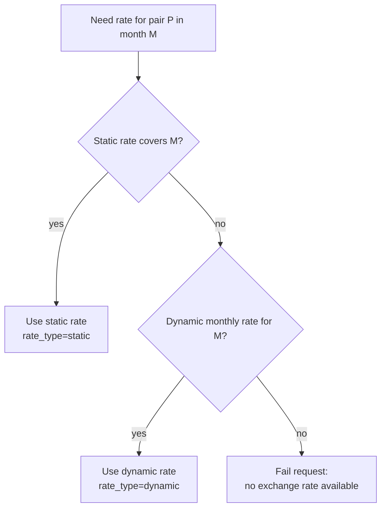

# Constant Currency Design

Product and data design for constant currency: what is stored, how rates are
chosen, and how time and retention behave. See [api.md](./api.md) for endpoints
and [README.md](./README.md) for user flows.

---

## Entities

All tenant-facing configuration is **per customer schema**.

### Enabled currency

A currency is available in UI pickers and for dynamic monthly-rate population
when it is enabled for the tenant.

- Enablement is normally an administrator action
  (`POST …/settings/currency/enabled/{code}/`).
- **Exception:** currencies that appear as **base currencies in cloud provider
  billing data** (AWS, Azure, GCP) are **auto-enabled** after those providers’
  summary tables are updated for the processed date window.
- Presence of the currency in the tenant’s enabled set means “enabled”.
- At least one currency must remain enabled.
- Market discovery alone does **not** auto-enable currencies for the dropdown.

### Static exchange rate

Customer-defined directional rate:

| Attribute                           | Rule                                                 |
| ----------------------------------- | ---------------------------------------------------- |
| `base_currency` → `target_currency` | Directional; reverse is a separate definition        |
| `exchange_rate`                     | Strictly positive; units of target per 1 unit of base |
| `start_date` / `end_date`           | Month-aligned (1st → last day of a month)            |
| Validity                            | No overlapping windows for the same directional pair |

Static rates are configuration. They override dynamic rates for months they
cover. They do **not** implicitly create a reverse static rate.

### Monthly exchange rate

Effective conversion rate used by reports/forecasts for one month and one pair.

| Attribute                           | Meaning                                    |
| ----------------------------------- | ------------------------------------------ |
| `effective_date`                    | First day of the month the rate applies to |
| `base_currency` / `target_currency` | Directional pair                           |
| `exchange_rate`                     | Multiplier for that month (target per 1 base) |
| `rate_type`                         | `static` or `dynamic`                      |

**One rate per** `(effective_date, base_currency, target_currency)`.

This is the single source of truth at query time when the constant-currency
feature flag is on.

### Market snapshot (shared)

A platform-wide latest cross-rate matrix still exists for:

- Legacy conversion when the feature flag is off
- Feeding dynamic monthly rates for the current month and the next month

It is not historical; historical stability comes from monthly exchange rates.

---

## Rate types

| Type        | Source                                                                                 | Mutability                                                                                                                      |
| ----------- | -------------------------------------------------------------------------------------- | ------------------------------------------------------------------------------------------------------------------------------- |
| **Static**  | Admin CRUD                                                                             | Create/update/delete may cover past months; STATIC monthly rows are rewritten for each month in the window, through the rate end, including future months |
| **Dynamic** | Market feed (when `CURRENCY_URL` is set) + inverse synthesis for missing reverse pairs | Current month and the next month are refreshed from the market snapshot; past months are finalized and are not rewritten by the daily refresh or static CRUD |

### Inverse / reverse pairs

- Defining `USD → EUR` static does **not** create `EUR → USD` static.
- For dynamic rates, if the market matrix has a forward rate, the reverse
`1/rate` may be synthesized when missing.
- Reports never chain multi-hop conversions (e.g. USD→EUR→CNY).

---

## Month lifecycle

| Period                      | Behavior                                                                                                                                              |
| --------------------------- | ----------------------------------------------------------------------------------------------------------------------------------------------------- |
| **Current month**           | Dynamic rates can be refreshed daily. Static CRUD upserts this month when the static window includes today.                                           |
| **Past months (finalized)** | Dynamic monthly rows are not rewritten by the daily refresh. Static CRUD may create/update/delete STATIC rows for past months in the retention window. |
| **Next month**              | Dynamic rows are written and refreshed daily from the latest market snapshot, skipping pairs that already have a static rate for that month. Static windows that include this month write their STATIC row when the definition is saved and again on the daily rematerialize. |
| **Later future months**     | A static definition writes a STATIC row for every month through its end date. Dynamic rates are not written past the next month.                      |

### Static rate lifecycle

| Action       | Allowed when                                 | Effect on monthly rates                                                                                                                      |
| ------------ | -------------------------------------------- | -------------------------------------------------------------------------------------------------------------------------------------------- |
| Create       | Month-bound window; no overlap for the pair  | Writes STATIC monthly rows for each month from max(start, retention) through the rate's end month, including future months                    |
| Update (any) | `base_currency` is immutable                 | Delete and recreate to change base. Scope/rate changes rewrite STATIC rows in the new window (retention through the new end). Months that leave the window lose their STATIC row. The current month and the next month fall back to the market snapshot when no static definition still covers them; past gaps use next-later MER backfill. Today's market rate is not written into closed months or into months beyond the next month |
| Delete       | Always (subject to auth)                     | Removes STATIC overrides in the window (retention through the rate end, including future months). The current month and the next month are restored from ERD when possible; past gaps use next-later MER backfill (not today's ERD). Months beyond the next month are left without a dynamic row |

---

## Currency enablement design

| Rule                 | Detail                                                                                       |
| -------------------- | -------------------------------------------------------------------------------------------- |
| Dropdown contents    | Enabled currencies only (`GET /currency/`)                                                   |
| Settings catalog     | Full ISO list with `enabled` + `has_dynamic_rate` + `active_rate_type` + nested static rates |
| Auto-enable          | Base currencies from cloud provider billing (AWS/Azure/GCP) are enabled after summarization  |
| Disable blocked when | System default, account default, used by cloud provider billing, cost models, or price lists |
| Last currency        | Cannot disable the final enabled currency                                                    |
| Dynamic population   | Only **enabled** currency pairs receive dynamic monthly rates                                |

Unlike earlier design drafts, static-rate currencies are **not** automatically
shown in the end-user dropdown unless those currencies are also enabled.
Cloud bill base currencies are an intentional exception to “admin-only”
enablement: they are turned on when summarization finds them in provider cost
data, then behave like any other enabled currency (including disable blocking
while still used by cloud billing).

---

## Report conversion design

When `cost-management.backend.constant-currency` is enabled for the tenant:

1. Determine the target currency from the request / user settings (must be
  enabled).
2. For each cost row’s usage month, look up
  `monthly rate(base → target)` for that month.
3. OCP continues to convert:
  - cost-model denominated amounts using the cost model’s currency
  - infrastructure / raw bill amounts using the bill’s currency
4. Validate coverage for the full query range up front: every distinct base
  currency that needs conversion must have a monthly rate for every month in
   range.
5. Gaps → `400` with an actionable message (no partial unconverted payload).

When the flag is off, behavior stays on the legacy single latest matrix for all
months.

---

## Daily rate maintenance

Conceptual daily job (product behavior, not task wiring):

1. If `CURRENCY_URL` is set, fetch the latest market rates and refresh the
  shared market snapshot.
2. If `CURRENCY_URL` is empty, skip the fetch; existing snapshot / static rates
  remain usable.
3. For each tenant:
  - Rematerialize STATIC monthly rates from the current month through each
   `StaticExchangeRate` definition's end date, for enabled pairs only. This
   restores overrides after a currency is re-enabled and keeps future months
   inside the window written before they start. Past (finalized) months are
   not rewritten.
  - Upsert dynamic monthly rates for the **current month and the next month**
   for remaining enabled pairs, skipping a pair in a month that already has a
   static override (from the rematerialized definition, or an existing STATIC
   MER row). The next-month row is provisional and is refreshed on every run.
  - **Backfill** missing past months inside the retention window
  (see below). The provisional next-month row is not a backfill source.
  - Invalidate cached report views when monthly rates changed.

New tenant schemas do not wait for that daily job. `template0` is cloned with
its table data, and on a fresh database that template has an empty
`MonthlyExchangeRate` table because it is migrated before any market snapshot
exists. After [`Tenant.create_schema`](../../../koku/api/iam/models.py) commits
a clone, it runs the same current-and-next-month upsert and retention backfill for that
schema from the shared `ExchangeRateDictionary`
([`populate_monthly_rates_for_schema`](../../../koku/cost_models/monthly_exchange_rate_utils.py)).
If the dictionary is empty, that path fetches rates into ERD first when
`CURRENCY_URL` is configured
([`ensure_exchange_rate_dictionary`](../../../koku/api/currency/utils.py)), then
writes MER for the new schema only (it does not crawl every tenant). The daily
job remains the refresh path. A failed fill is logged and does not roll back
schema creation.

### Backward-looking backfill

Purpose: after enablement, deploy, or gaps in daily runs, ensure every month in
the retention window that has a later known rate for a pair also has earlier
months filled so multi-month reports do not fail coverage checks.

Rules:

- Only **creates** missing rows; never overwrites existing monthly rates.
- Walks **backward** from the newest existing rate for each pair.
- Each missing month inherits the **next later** existing rate for that pair.
- Example (retention Jan–Jun, rows at Apr and Jun):
`May ← Jun`, `Mar ← Apr`, `Feb ← Apr`, `Jan ← Apr`.
- Backfilled rows are stored as `rate_type=dynamic`.
- Window start is the same retention boundary used for cost data retention.

---

## Retention

Monthly exchange rates follow the tenant’s cost-data retention window:

- Default platform retention is `RETAIN_NUM_MONTHS` (default **4** months,
including the current month), overridable per tenant via data-retention
settings when configured.
- Rates with `effective_date` before that window start are purged during
expired-data cleanup (supports simulate mode like other cleaners).
- Backfill never creates rows outside that window.

This keeps monthly rates aligned with months that can still appear in retained
reports.

---

## Deployment modes

| Mode                                    | Behavior                                                                                                                |
| --------------------------------------- | ----------------------------------------------------------------------------------------------------------------------- |
| Market feed configured (`CURRENCY_URL`) | Daily dynamic refresh + backfill; static overrides still win                                                            |
| No market feed                          | Dynamic fetch skipped; static rates and any previously stored monthly rates remain; missing pairs error at query time   |
| Feature flag off                        | Legacy single-matrix conversion; Settings APIs may still manage enablement/static config for when the flag is turned on |

---

## Design decisions

| Decision                       | Choice                                                                    |
| ------------------------------ | ------------------------------------------------------------------------- |
| Source of truth for conversion | Monthly exchange rates (per month, per pair)                              |
| Static vs dynamic precedence   | Static wins for covered months                                            |
| Reverse static rates           | Not auto-generated; define both directions if both are required as static |
| Currency visibility            | Dropdown = enabled set only; enablement is admin or cloud-bill auto-enable |
| Month writing                  | Static rows through the configured end month. Dynamic rows for the current month and one month ahead. Past months stay finalized |
| Historical gaps                | Backward-looking fill from next later rate within retention               |
| New tenant schema              | Fill monthly rates from the shared snapshot when the clone commits        |
| Query-time missing rate        | Hard error (`400`), not silent omit or cross-month substitution           |
| Multi-hop conversion           | Not supported                                                             |
| Retention                      | Same window as retained cost months                                       |
| Feature rollout                | Unleash `cost-management.backend.constant-currency`                       |
