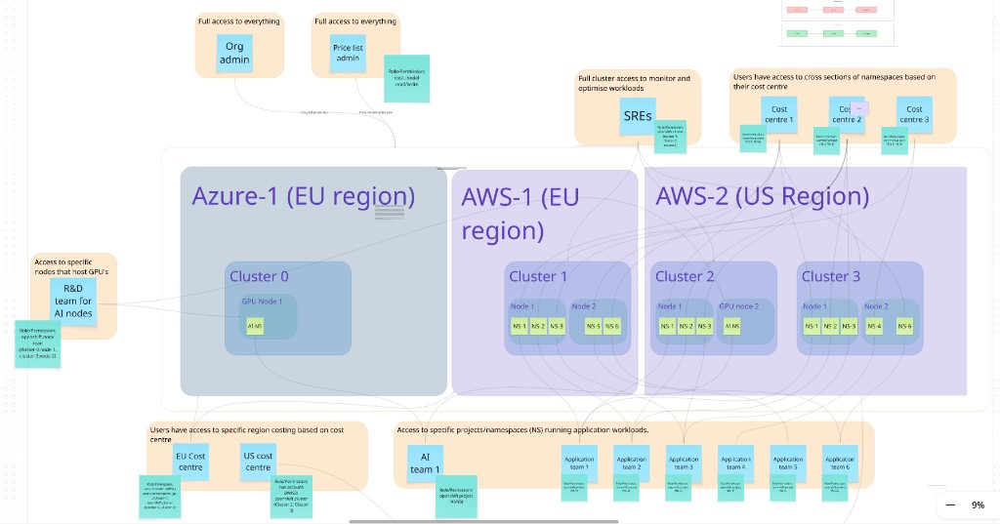
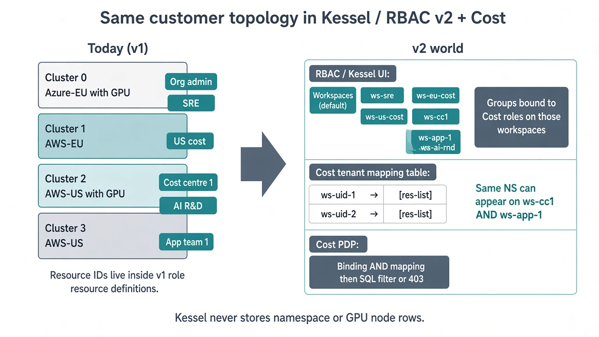
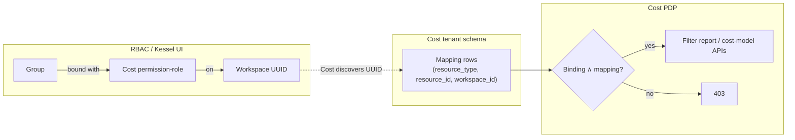
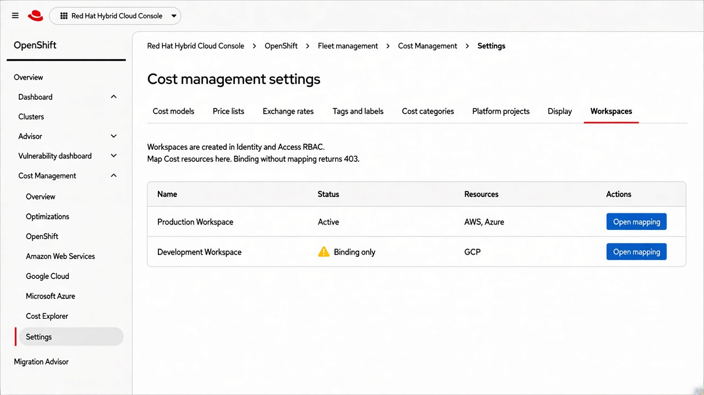
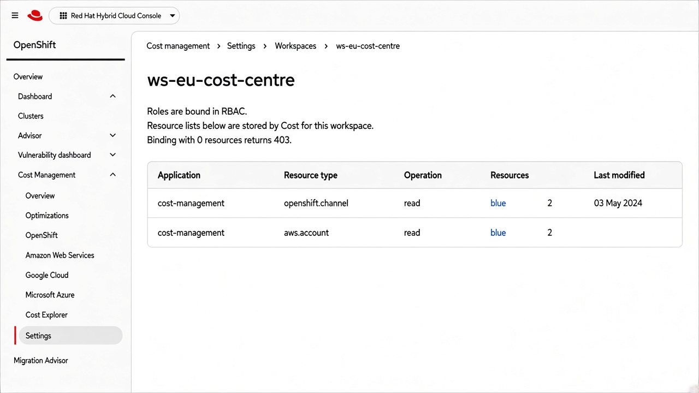
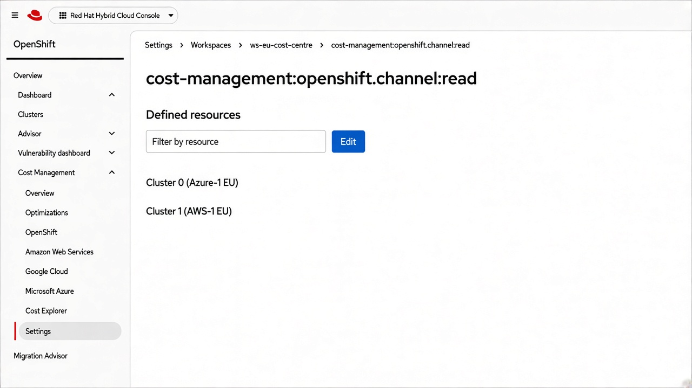
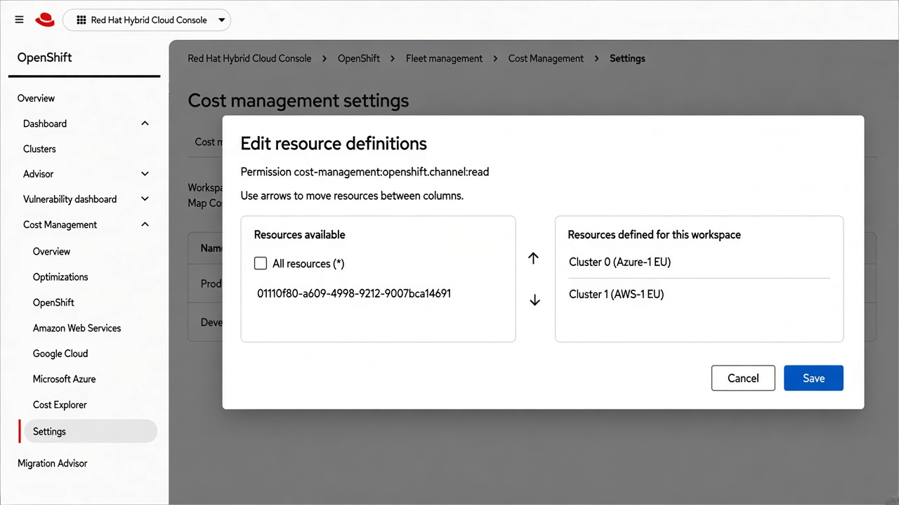
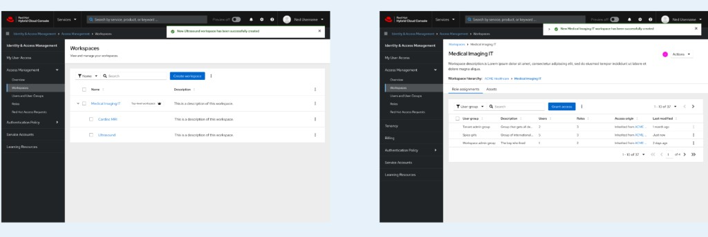

# RBAC v2 design — minimal Cost integration

**Status:** draft share-out (architecture). Experimental implementation: [#6477](https://github.com/project-koku/koku/pull/6477) (`RBAC_BACKEND=v1` by default).  
**Audience:** Project Kessel, RBAC v2, Platform IAM, Cost Management.

The smallest SaaS migration away from RBAC v1 that still uses the platform for identity: **RBAC v2 owns users, groups, and the grant store; Cost owns the permission semantics, the objects, and the evaluation.** Kessel is a replication target, not a decision point on the Cost request path.

This design supersedes the "Cost → Kessel outbox" plan for the immediate migration. The outbox approach is not wrong; it is simply not needed for this shape and remains a deferred resource-reporting path.

> [!tip] One sentence
> Bind groups to a small set of Cost permission-roles **on an opaque workspace ID**, keep `object → workspace_id` (many-to-many) in Cost, and evaluate reports locally. No outbox, no tuples, no `ReportResource`, no `cost-management.ksl`.

**Naming in examples:** `group-…` = RBAC **group** (who); `ws-…` = **workspace** (opaque UUID from the RBAC / Kessel UI).

---

## Constraints that force this shape

1. **Cost cannot integrate with BOP or IT Service** — users, service accounts, groups, and membership must come from Kessel/RBAC v2. That rules out rbac-mini (rbac-go) as a SaaS authority.
2. **RBAC v1 is being decommissioned in SaaS.** Keeping `/api/rbac/v1/access/` is a temporary bridge, not a destination.
3. **Sources are outside Cost’s remit** (`sources-api-go` / Integrations). Cost must not define a `source` resource type, report sources, or write source tuples.
4. **Granular rights stay with Cost** — clusters, nodes, projects, accounts, cost models, settings, rates. Only the *grant storage and subject directory* move to the platform.
5. **Enterprise N:M scopes** (same cluster/NS under SRE, cost centre, app team, AI) cannot live as SpiceDB parents without tags / hierarchy explosion — Cost mapping absorbs that.

---

## Alternatives considered

Options for leaving RBAC v1, with the trade-offs that led to this design.

| Approach | Grants stored in | Kessel on Cost report path | What Cost must build | Main blocker / cost |
|---|---|---|---|---|
| **A. RBAC v1** (status quo) | v1 policies + resource definitions | no | nothing | v1 is being decommissioned in SaaS |
| **B. v2 grant store** (**adopted**) | v2 roles + role bindings | **no** (replication only) | v2 client, workspace mapping, local evaluation | platform must allow Cost permissions on v2 roles + dual-read window for A/B |
| **C. Outbox + Kessel reporting** | Inventory / relations | yes (`Check`) | outbox, relay, schema, resource reporting | no `source` type; schema work; Cost must not write RBAC’s relation-replication topic |
| **D. Workspace-only** | workspaces + workspace `Check` | yes | coarse workspace mapping only | **over-exposes**: everyone bound to a workspace sees all objects mapped there — loses per-account/cluster/NS narrowing. **Not an acceptable fallback** for Cost |
| **E. rbac-mini in SaaS** | Cost-owned tables | no | BOP/IT adapter | identity must come from BOP/IT; Cost cannot integrate |

**Why B wins**

- Removes the v1 dependency without putting Kessel `Check` on the report path.
- Users / groups / grants stay on the platform (only place allowed to talk to BOP/IT).
- Cost keeps permission semantics (report filters, OCP-on-cloud intersection, N:M scopes).
- No outbox, no `ReportResource`, no `cost-management.ksl` for Cost objects in Phase 0.

**C (outbox)** stays deferred, not cancelled: worthwhile only if another service must answer “which Cost resources can this user see?” via Kessel. Until then it does not remove local evaluation anyway. Cross-project note: Host Inventory is the reference producer for `outbox.event.kessel.tuples`; most other apps consume Checks or the v2 RBAC API. Cost must not become a second writer of RBAC’s `outbox.event.relations-replication-event`.

**D** is documented so the trade-off is visible — we are **not** proposing it. Workspace-only authorization would collapse the prod topology (SRE vs cost centre vs app team vs AI) into “everything in the workspace,” which over-exposes users.

**E** is excluded by the identity constraint. rbac-go remains on-prem only.

**Recommendation for platform readers:** adopt **B** now; keep **C** as a later phase if resource-level Checks are required by other consumers; do not use **D** for Cost.

---

## Architecture

```
                    ┌──────────────────────────────────┐
   user identity ──▶│  RBAC v2                         │
   (x-rh-identity)  │  users · groups · roles          │
                    │  bindings (group, role, wspace)  │
                    └───────────────┬──────────────────┘
                                    │ replication only
                                    ▼
                            ┌───────────────┐
                            │ Kessel        │  no Cost Check calls
                            │ (SpiceDB)     │  on the report path
                            └───────────────┘
                                    ▲
                    read bindings   │   (no Cost resource writes)
                    + role perms    │
                    ┌───────────────┴──────────────────┐
                    │  Cost Management (koku)          │
                    │  · permission semantics (PDP)    │
                    │  · object ↔ workspace_id (N:M)   │
                    │  · report SQL access filters     │
                    │  · allow / 403 decision          │
                    └──────────────────────────────────┘
```

| Component | Role |
|-----------|------|
| **RBAC v2 / Kessel** | Grant store + subject directory. Replicates into SpiceDB for apps that use `Check`. |
| **Cost** | **PDP for Cost resources.** Reads bindings via REST, joins local mappings, evaluates in SQL. |
| **Kessel `Check`** | Not used for Cost account/cluster/namespace/cost-model auth on the report path. |

Inventory/`Check` may still gate **RBAC management APIs** (create role/binding). That is platform plumbing, not Cost report authorization.

---

## The grant model

v2 stores `(subject, role, resource)` — not `(group, permission, workspace)` with embedded resource IDs:

```
binding : group|user  +  role  +  workspace (resource_type=workspace, resource_id=<uuid>)
role    : name + permission list   // ZERO resource IDs
```

**One-permission Cost roles** (not coarse Viewer/Admin) so v1→v2 stays mechanical. A v2 binding applies the *whole* role to a workspace — one permission per role avoids over-grant when a v1 role mixed AWS and OCP resource definitions.

### Permission verbs (production v2 catalog — locked)

Report types have **no write**. Cost models and settings use **read or write only** (`write` implies `read`). Do **not** seed verb `*` on those types — it is ambiguous and unnecessary.

| Permission (RBAC role) | Verb meaning | Used for |
|---|---|---|
| `cost-management:*:*` | special org-admin wildcard | full Cost access (Cost fast path; no per-type mapping required) |
| `cost-management:aws.account:read` | read | AWS account report scoping |
| `cost-management:aws.organizational_unit:read` | read | AWS OU-scoped access |
| `cost-management:azure.subscription_guid:read` | read | Azure subscription scoping |
| `cost-management:gcp.account:read` | read | GCP account scoping |
| `cost-management:gcp.project:read` | read | GCP project scoping |
| `cost-management:openshift.cluster:read` | read | OCP cluster report scoping |
| `cost-management:cost_model:read` | read | read-only cost models / price lists |
| `cost-management:cost_model:write` | write (+ implied read) | create/update cost models |
| `cost-management:settings:read` | read | read-only settings |
| `cost-management:settings:write` | write (+ implied read) | change settings |

> [!note] Why not `aws.account:*`?
> In today’s v1 catalog many report permissions are stored as `…:*`. In koku that does **not** mean read+write — `RESOURCE_TYPES` for accounts/clusters only lists `read`, so `*` collapses to read. For v2 we seed **`:read`** explicitly so RBAC/Kessel readers are not misled. Legacy `:*` on report types, if still present in rbac-config, maps to the same read role during migration.

**Only remaining `*` that means “all resources”** is in the **Cost mapping table** (tenant schema), e.g. `(aws.account, *, workspace_uuid)` — not on the RBAC permission verb (except org-admin `cost-management:*:*`).

| Where | Example | Meaning |
|------|---------|---------|
| RBAC role verb | `…:aws.account:read` | May use that permission on the bound workspace |
| Cost mapping resource id | `*` or `[111, 222]` | Which accounts/clusters/cost-model UUIDs that workspace covers |
| Org admin | `cost-management:*:*` | Full Cost access; Cost does not require per-type mapping rows |

**Workspaces** are opaque UUIDs to Cost. Created/deleted **only in the Kessel / RBAC UI**. Phase 0 evaluation is **flat** (same as today): Cost does not walk `parent_id`.

**Effective access = binding ∧ Cost mapping.** Missing either (including no bindings) → **403**. Binding present but mapping empty → **403**. Valid grant with no query rows → **200 `[]`**.

---

## From the v1 customer topology to the v2 world

### Today (v1) — overlapping grants on the same clusters



What the whiteboard is showing (inventory only):

| Where | Cluster | Notable objects |
|-------|---------|-----------------|
| Azure-1 · EU | Cluster 0 | GPU Node 1, AI NS |
| AWS-1 · EU | Cluster 1 | Nodes + NS1–NS6 |
| AWS-2 · US | Cluster 2 | GPU Node 2, AI NS, NS mix |
| AWS-2 · US | Cluster 3 | Nodes + NS1–NS6 |

Personas drawn on top of those clusters today (v1) put **resource ids inside role resource definitions**. The same cluster or namespace is “in” many personas at once (SRE + cost centre + app team + AI). That overlap is what SpiceDB cannot parent 1:1 — and why Cost keeps an N:M mapping table.

### Same topology reflected in v2



**Translation rule (every persona follows the same three steps):**

```text
1. RBAC UI   create workspace W (opaque UUID) + group
2. RBAC UI   bind Cost permission-role(s) on W     ← verb only (read, or write for cost_model/settings)
3. Cost UI   map concrete resources (or *) onto W  ← scope; tenant-schema table
             access = step 2 ∧ step 3, else 403
```



Kessel stores **groups, roles, workspace UUIDs, bindings**. It does **not** store namespace lists, GPU nodes, or account ids for Cost.

### Walkthrough — each persona from the diagram

Use this as a checklist when reading the whiteboard: find the persona → find its workspace → see what Cost maps.

#### 1. Org admin / Price list admin (“full access to everything”)

```text
RBAC:  workspace default
       group-org-admins      ← bind cost-management:*:*  (and/or all Cost roles)
       group-price-list-admins ← bind cost-model:write (implies read)
Cost:  org-admin (*:*) → full access fast path; price-list admin → map cost_model UUIDs or * on default
```

They see every cluster (0–3), every account, every cost model. No per-NS narrowing needed.

#### 2. SREs (“full cluster access to monitor and optimise”)

```text
RBAC:  workspace ws-sre-platform
       group-sres ← bind cost-openshift-cluster-read
Cost:  map cluster-0, cluster-1, cluster-2, cluster-3 onto ws-sre-platform
```

SRE reports include all four clusters. They do **not** automatically get AWS account–side OCP-on-cloud rows unless cloud-account roles + mappings exist too (Cost local AND).

#### 3. EU cost centre / US cost centre (region buckets on the diagram)

Region is **not** a Kessel permission. The diagram’s EU/US boxes become **two workspaces** whose Cost mappings happen to be regional:

```text
RBAC:  ws-eu-cost-centre  ← group-eu-cost  + cluster/account read roles
       ws-us-cost-centre  ← group-us-cost  + cluster/account read roles
Cost:  EU → cluster-0, cluster-1 + Azure-1/AWS-1 accounts (+ EU NS set if needed)
       US → cluster-2, cluster-3 + AWS-2 accounts (+ US NS set if needed)
```

#### 4. Cost centres 1 / 2 / 3 (namespace cross-sections)

These are the overlapping NS slices across clusters:

```text
RBAC:  ws-cost-centre-1 ← group-cc1 + cost-openshift-cluster-read
Cost:  map the CC1 namespace set (e.g. NS1, NS2, …) and the parent cluster ids
       those namespaces run on (often cluster-1 and/or 2/3)
```

Same pattern for CC2 and CC3 on their own workspaces. **The same `NS1` row can also appear under an app-team workspace** (N:M) — see below.

#### 5. R&D / AI nodes (GPU Node 1 on Cluster 0, GPU Node 2 on Cluster 2)

```text
RBAC:  ws-ai-rnd-nodes ← group-ai-rnd + cluster read (and node/project if grantable)
Cost:  map cluster-0 + cluster-2, plus node/project (AI NS) rows for the GPU nodes
```

If `openshift.node` is not grantable on v2 roles, Cost still scopes via mapping + cluster synthesis (platform catalog ask).

#### 6. AI team 1 + Application teams 1–6

```text
RBAC:  ws-ai-team-1   ← group-ai-team-1   + cluster read
       ws-app-team-N  ← group-app-N       + cluster read
Cost:  map only that team’s project/namespace ids (+ parent cluster ids)
```

### Why one namespace appears twice (the N:M point)

Whiteboard: cost centre **and** an application team both “own” overlapping namespaces.

```text
Cost mapping table (tenant schema):

  openshift.project | ns1 | ws-cost-centre-1
  openshift.project | ns1 | ws-app-team-1      ← same NS, second workspace
  openshift.cluster | cluster-1 | ws-cost-centre-1
  openshift.cluster | cluster-1 | ws-app-team-1
```

SpiceDB never parents `ns1` under two workspaces. Cost’s table does. A user in **only** `group-app-1` never sees CC1’s other namespaces.

### Quick access checks (same topology)

| User in… | AWS EU report | OCP Cluster 0 | OCP NS1 on Cluster 1 | Cost model UUID X |
|----------|---------------|---------------|----------------------|-------------------|
| Org admin | yes (`*`) | yes | yes | yes (`*`) |
| SRE only | 403 unless account mapped | yes (cluster mapped) | yes if cluster-wide map | 403 (no cost-model role) |
| EU cost only | EU accounts only | yes | if NS1 in EU/CC map | 403 unless mapped |
| App team 1 only | 403 | 403 unless their NS’s cluster mapped narrowly | only if NS1 mapped to `ws-app-team-1` | 403 |
| Binding but Cost mapping empty | **403** | **403** | **403** | **403** |

---

## How Kessel models roles (background)

Kessel/SpiceDB has no native `Role`. RBAC v2 models one as a resource with one relation per permission. Migrated apps wire workspace perms as `t_binding->… + t_parent->…`.

**The gap that keeps Cost’s evaluation local:** on `rbac/workspace`, `cost_management_*` is not wired with `t_binding->`. A v2 role can *store* a Cost permission, but a workspace `Check` for it returns false. **Intentional for this design** — we do not ask Kessel to wire Cost into workspace `Check` for the 6-month migration. Cost reads bindings and decides locally.

---

## API surface used

| Call | Purpose | Notes |
|---|---|---|
| `GET /api/rbac/v2/role-bindings/?granted_subject_type=user&granted_subject_id=<uuid>` | effective bindings | group-derived included; `subject_type=user` alone is direct-only |
| `GET /api/rbac/v2/roles/{uuid}/` | permission strings | |
| `GET /api/rbac/v2/workspaces/` | opaque workspace IDs | Cost discovers; does not create |
| `GET /api/rbac/v2/groups/`, `/principals/` | directory | principals list is DB-backed, not full BOP search |
| `POST /api/rbac/v2/roles/`, `/role-bindings:batchCreate/` | seed / bind | Cost editor path |

---

## Ownership split

| Concern | Owner |
|---|---|
| Users, service accounts, org admin | RBAC v2 / BOP + IT |
| Groups and membership | RBAC v2 |
| Grant storage (subject, role, workspace) | RBAC v2 |
| Workspace create/delete | **Kessel / RBAC UI only** |
| Permission catalog strings | rbac-config |
| Permission semantics + resource scope (`*` / IDs), incl. cost-model UUIDs | **Cost** (tenant-schema mapping table) |
| Report / cost-model / settings evaluation | **Cost** |
| Sources / Integrations | **Outside Cost** |

---

## What this deletes

- transactional outbox, relay, tombstones, reconciler for Cost resources
- `ReportResource` / Inventory resource reporting from Cost
- a Cost-owned Kessel `source` type
- `cost-management.ksl` as a migration dependency
- per-resource tuples / Kessel `Check` on the Cost report path
- Cost creating workspaces

Deferred (not cancelled forever): outbox / resource reporting if product later needs Kessel-visible Cost objects.

---

## Blockers and prerequisites

> [!warning] Hard blocker today
> `cost-management` is in `V2_MIGRATION_APP_EXCLUDE_LIST` by default. Cost permissions cannot be stored on a v2 custom role until RBAC clears that — ideally **without** immediately making v1 `/access` return 400 for Cost (see asks below).

Other constraints:

- One scope per role (don’t mix `rbac_*` with `cost-management:*`).
- Per-org v2 opt-in; writes gated; dual-read needed during transition.
- Unscoped binding reads are admin-gated → S2S identity needed.
- v2 management APIs depend on Inventory/`Check` even though Cost reports do not.

---

## Topics to discuss with Kessel / RBAC

Platform-side changes or decisions. Cost cannot fix these alone. **Side-by-side A/B compare, compose testing, and stage are Cost intents that require Kessel/RBAC to enable them.**

| # | Topic | Ask | Why it blocks us |
|---|---|---|---|
| 1 | Tenant opt-in irreversible | Downgrade path or documented invariant + recovery | No real Unleash rollback after activation |
| 2 | Exclude list is two switches | Decouple “v2 Cost roles allowed” from “v1 `/access` still served” | Enabling v2 kills the v1 baseline for A/B |
| 3 | v1 `/access` hard-fail for v2 orgs | Machine-readable error code | No safe detect/fallback without string match |
| 4 | S2S binding reads | Documented S2S/PSK + org scope + rate guidance | Shadow compare and runtime reads |
| 5 | Side-by-side A/B window | Keep v1 baseline **and** v2 Cost roles concurrently for a cohort | Cost will implement shadow diff **only if** 1–4 make it possible |
| 6 | Docker Compose contract | Recommended way for Cost to test on `make kessel-up`; who owns overlay (BOP bypass, exclude list, ports)? | Day-to-day implementation testing |
| 7 | Stage (or shared non-prod) | Dedicated stage org with workspaces + Cost exclude-list transition? | Demo / canary with other teams |
| 8 | Opt-in/bootstrap readiness | Ready vs 403 signal | Labs and stage onboarding |
| 9 | `source` type | Confirm workspace-level / Sources-owned; Cost will not report `source` | Keep Sources out of Cost’s Kessel remit |
| 10 | Catalog | Prefer seeding report types as `:read` (not `:*`); cost_model/settings as `:read`/`:write` only; `openshift.node` / `openshift.project` grantable? | Clearer verbs; GPU/NS topology |
| 11 | `fields` grammar | Document `role(name),resource(name)` | Easy to get wrong on binding reads |
| 12 | RBAC UI expectations | Cost-seeded roles in binding picker; deep link to Cost mapping? | Cross-team UI split |
| 13 | Documented production binding-read query | Canonical S2S query shape for “effective bindings for user U in org O” (incl. group-derived) | Cost runtime + A/B shadow depend on one supported contract |

**Not asked for Phase 0:** wiring `cost_management_*` into workspace `Check`.

### Side-by-side A/B (Cost intent; you must enable it)

Cost wants Phase A: enforce v1, also compute v2 (bindings + mapping), log diffs (`v1_only` / `v2_only` / `both` / `neither`). That is one request → two auth computations — **not** two UIs and not `Check` vs SQL.

Without asks **1–5**, that window collapses when Cost leaves the exclude list or a tenant write-activates. Please treat dual-read/dual-write as a platform deliverable Cost depends on.

---

## Notes carried over

- **Regions are not an authorization scope** — report filter / group-by only.
- **OCP-on-cloud is an intersection** — Cost keeps `cluster IN (…) AND account IN (…)`.
- **Empty v1 resource definitions → `*`** in Cost mapping.
- **Semantics preserved from v1:** grants are additive across groups/roles; Cost mapping resource `*` collapses to all ids of that type; `write` implies `read`; `openshift.node` / `openshift.project` remain synthesized from cluster access unless the catalog makes them first-class; `cost-management:*:*` org-admin fast path unchanged; ignore non–cost-management resource types on platform roles.
- **v2 verbs are explicit:** report types use `:read` only; cost_model/settings use `:read` or `:write` only — no permission-verb `*` except org-admin `:*:*`.
- **On-prem:** rbac-go remains v1; unaffected.

---

## Rollout

**Flags (callout):** production needs **per-tenant** control (Unleash on `org_id`), not a process-wide switch alone. Draft names: `RBAC_V2_GRANTS` (read / shadow-capable), `RBAC_V2_GRANTS_WRITE` (editor). An experimental process-wide `RBAC_BACKEND=v1|v2` plus `RBAC_V2_SHADOW` exists in exploration code — that is insufficient for staged SaaS canary; treat per-tenant flags as the production contract.

1. Build Cost `object ↔ workspace_id` mapping (opaque UUIDs from RBAC UI); backfill from v1 resource defs (see topology scenarios).
2. Seed ~11 Cost roles; create bindings that mirror v1 groups.
3. **Shadow compare** v1 vs v2 for a cohort — **requires Kessel asks 1–5**.
4. Switch enforcement per endpoint group (reports first, cost models last) when drift is acceptable.
5. Keep v1 until cohort is done; then remove.

```text
Phase A — Shadow (reversible for Cost; needs platform dual-read window)
Phase B — Enforce v2 with v1 fallback (same window)
Phase C — Enforce v2 only
```

---

## UI wireframes (pre-UXD)

All Cost sketches are **light mode**, aligned with today’s Cost Management Settings shell. Resource-definition UX mirrors RBAC v1 (roles → defined resources → dual-list edit), but lives under Cost **Settings → Workspaces** and writes Cost’s tenant mapping table (not RBAC).

### Information architecture

| Surface | Where | Owns |
|---------|--------|------|
| **Workspaces** (new) | Tab under **Settings** (same row as Cost models / Price lists / …) — not a left-nav item | Entry point: workspaces Cost can map |
| **Fig. 1 — Roles in workspace** | Drill-down from a workspace row | Permissions already bound in RBAC for that workspace; **Resources** link opens Cost’s resource list |
| **Fig. 2 — Defined resources** | Drill-down from a permission’s **Resources** count | Concrete ids (or `*`) Cost stores for that workspace + permission |
| **Fig. 3 — Edit resource definitions** | **Edit** on Fig. 2 | Dual-list picker (`*` / move ids); Save → tenant-schema mapping only |
| **Workspace + grant access** | Identity & Access → User Access → **Workspaces** (platform RBAC UI) | Create workspaces; grant groups Cost roles on a workspace |

```text
Cost Management → Settings → Workspaces
  → (workspace) → Fig.1 permissions table
    → Resources → Fig.2 defined resources → Edit → Fig.3 dual-list
Identity & Access → User Access → Workspaces → (detail) → Grant access / Roles
```

### 1. Cost Settings → Workspaces tab (light)



Lists RBAC workspaces Cost knows about (e.g. `default`, `ws-sre-platform`, `ws-eu-cost-centre`, `ws-ai-rnd-nodes`), read-only bound groups, mapping summary, and **Binding only → 403** when Cost mapping was skipped.

### 2. Fig. 1 — Roles / permissions in a workspace (light)



Opened from a workspace row. Same shape as v1 “permissions on a role”: Application / Resource type / Operation / **Resources** / Last modified. Example: `ws-eu-cost-centre` with RBAC already binding `openshift.cluster:read` and `aws.account:read` for `group-eu-cost`. Roles themselves are **not** edited here — only Cost’s resource counts / links.

### 3. Fig. 2 — Defined resources for one permission (light)



Opened from the **Resources** link on Fig. 1. Lists the Cost-side scope for that workspace + permission (cluster ids, account ids, …). Empty list ⇒ effective **403** even if RBAC binding exists. **Edit** opens Fig. 3.

### 4. Fig. 3 — Edit resource definitions (light)



v1-style dual-list (available ↔ defined), plus **All resources (`*`)** when the admin wants whole-type scope under that workspace. Cancel / Save write tenant-schema mapping rows only — RBAC bindings unchanged.

### 5. RBAC / Kessel UI (illustrative only)

> [!note] Rough example — not official UX
> The panel below is only a **guess** of how Identity & Access → Workspaces might look when an admin creates workspaces and grants group access (roles on a workspace). Names in the screenshot are illustrative; in our design those workspaces would be things like `ws-sre-platform`, `ws-eu-cost-centre`, `ws-app-team-1`, with groups such as `group-sres` / `group-eu-cost` granted Cost permission-roles (`:read` / `:write`). **The RBAC / Kessel UI team should replace this with official mocks** when available (e.g. from `insights-rbac-ui` / Chromatic).



**How this maps to our topology examples**

| In the illustrative UI | In our design |
|------------------------|---------------|
| Create workspace (list) | RBAC UI creates `ws-sre-platform`, `ws-eu-cost-centre`, … (Cost never creates these) |
| Workspace detail → User groups / Grant access | Bind e.g. `group-sres` + `cost-openshift-cluster:read` on `ws-sre-platform` |
| Roles on that workspace | Our one-permission Cost roles (`:read` / `:write`), not Inventory host roles |

Cost then finishes the job under **Settings → Workspaces → Fig. 1 → Fig. 2 → Fig. 3** for the same workspace UUID.

## Test / demo environments (Kessel asks)

Production share-out does not depend on a local lab narrative. What we need from the platform:

- **Ask #6** — documented way for Cost to exercise v2 APIs in a shared or local Kessel stack (Compose or equivalent).
- **Ask #7** — whether **stage** (dedicated org + exclude-list transition) is available for demos and A/B.

---

## Cost models and settings (locked)

Same split as reports: **RBAC binds the verb; Cost scopes the objects.**

| Layer | Cost models | Settings |
|-------|-------------|---------|
| RBAC / Kessel | Bind `cost-model:read` **or** `cost-model:write` on a workspace UUID (no verb `*`) | Bind `settings:read` **or** `settings:write` (typically `default` / admin) |
| Cost mapping | Which **cost model UUIDs** (or `*`) that workspace exposes — preserves v1 fine-grained read/write | Usually `*` (org-wide APIs); no per-settings-object list today |

v1 grants for cost models must have the same effective access on v2: binding without Cost UUID mapping → **403**; mapping `*` → all cost models under that workspace scope; explicit UUID list → only those models (write still checked against the write role + mapped ids).

---

## Mapping table placement (locked)

The `object ↔ workspace_id` table lives in the **tenant schema**, not public.

Cost resources (accounts, clusters, projects, cost models, …) are already tenant-scoped and are not exposed on the public schema. A public mapping table would be a separate architectural change; this design does not take that on. Per-tenant flags / Unleash still key off `org_id` at the request edge; the rows themselves stay with the tenant’s data.

---

## Open questions (Cost-owned)

- Shadow-compare success criteria (which endpoints / drift rate gate Phase B)?
- Exact production Unleash flag names.
- Whether Cost sources list/stats later filters by mapping (product; still not a Kessel `source` type).
- Replace lo-fi wireframes with official UXD.

Resolved in this share-out: ~11 roles; flat Phase 0; workspaces RBAC-UI-only; Sources out of Cost; Cost = PDP; binding∧mapping or 403; N:M mapping in Cost; cost-model/settings verbs on RBAC + fine-grained scope in Cost; mapping table tenant-schema; A/B desired but platform-gated; **D is not an acceptable fallback**.

---

## References

**This share-out**

- Topology + wireframe assets: [`./assets/`](./assets/)
- Catalog entry: [`docs/architecture/README.md`](../README.md)

**Exploration / prior draft:** [#6477](https://github.com/project-koku/koku/pull/6477) — this share-out supersedes that README for external discussion.

**Platform**

- [schema.zed](https://github.com/project-kessel/rbac-config/blob/master/configs/prod/schemas/schema.zed)
- [cost-management.json](https://github.com/project-kessel/rbac-config/blob/master/configs/prod/permissions/cost-management.json)
- [sources-api-go](https://github.com/RedHatInsights/sources-api-go)

---

## Changelog

| Date | Change |
|------|--------|
| 2026-11-26 | Replace Open mapping with light Fig.1–3 v1-style resource-definition flow |
| 2026-11-26 | Light Open mapping; RBAC section uses illustrative workspaces screenshot + disclaimer |
| 2026-11-26 | Light-mode Cost UI; point RBAC screen at insights-rbac-ui official mocks |
| 2026-11-26 | UI: Workspaces as Settings tab; clarify Cost vs RBAC screens |
| 2026-11-26 | Lock explicit verbs (`:read` / `:write`); clarify `*` is Cost resource scope only |
| 2026-11-26 | Topology→v2 walkthrough + reflection diagram; refreshed UI wireframes |
| 2026-11-26 | Lock cost-model/settings (RBAC verb + Cost UUID scope); mapping table tenant-schema |
| 2026-11-26 | Alternatives A–E; production-only focus; flag/D callouts |
| 2026-11-26 | Refactor to PR #6477 README layout; keep topology scenarios, wireframes, Kessel A/B/compose/stage asks |
| 2026-11-26 | Prod topology, wireframe images, Kessel asks for A/B+compose+stage |
| 2026-11-25 | Initial draft from two-tier narrative + locked decisions |
